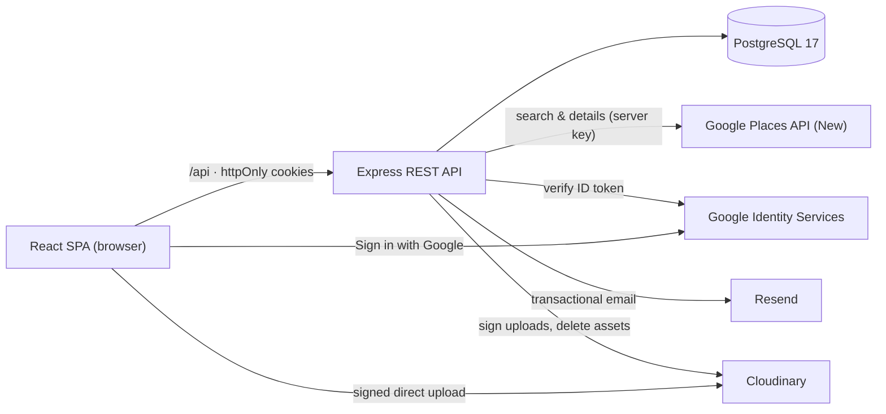
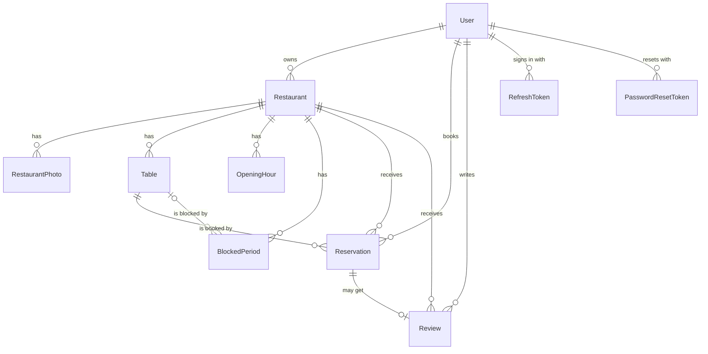
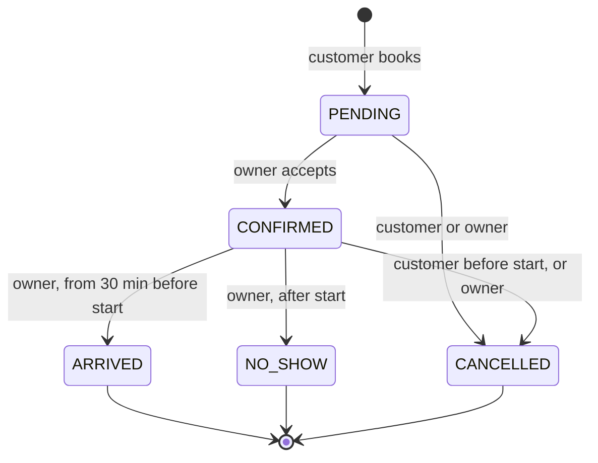
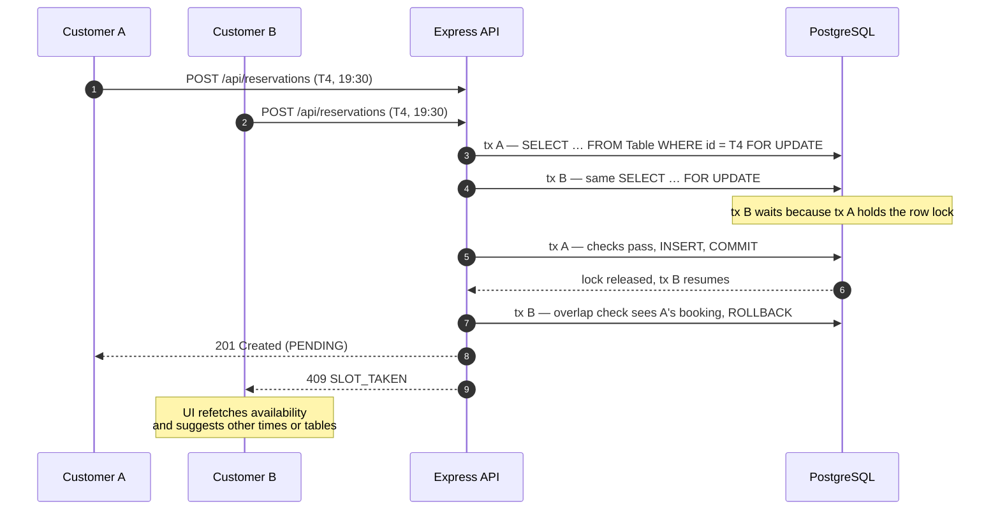

# Seghan: Project Plan

| | |
|---|---|
| **Status** | Draft v2, 3 November 2026: Core/Advanced split, overnight availability, one locking protocol, version check, verification plan |
| **Project** | Yerevan Restaurant Reservation Platform: internship project, full-stack web application |
| **Public name** | Seghan ([§1.2](#12-product-name)) |
| **Stack** | React (Vite, TS), React Router, Tailwind · Express (TS) REST API · PostgreSQL + Prisma · JWT + Google OAuth · Google Places, Cloudinary, Resend |
| **Core challenge** | Zero double bookings, enforced by PostgreSQL transactions and constraints ([§7](#7-double-booking-prevention)) |

Working conventions (commands, folder structure, coding rules) are in [CLAUDE.md](./CLAUDE.md).

## Contents

1. [Vision and Goals](#1-vision-and-goals)
2. [Users and Journeys](#2-users-and-journeys)
3. [Architecture](#3-architecture)
4. [Data Model](#4-data-model)
5. [REST API](#5-rest-api)
6. [Booking Rules and Availability](#6-booking-rules-and-availability)
7. [Double-Booking Prevention](#7-double-booking-prevention) ★ core challenge
8. [Auth and Security](#8-auth-and-security)
9. [External Integrations](#9-external-integrations)
10. [Execution Plan (8 Phases)](#10-execution-plan-8-phases)
11. [Out of Scope for v1](#11-out-of-scope-for-v1)
12. [Risks and Open Questions](#12-risks-and-open-questions)
13. [Seghan Design Integration](#13-seghan-design-integration)

---

## 1. Vision and Goals

**Vision.** Booking a table in Yerevan should take under a minute, and the result should be reliable. Customers see real availability, pick a table, and get a confirmation. Many restaurants still take bookings by phone or social-media messages. This platform gives them one simple dashboard for tables, hours and bookings, and gives diners one place to discover restaurants and reserve.

**Goals for v1**

| # | Goal | How we know |
|---|---|---|
| G1 | Fast booking | Restaurant page → submitted booking in under 60 seconds on a phone |
| G2 | **Zero double bookings** | Enforced by a database constraint, and proven by an automated concurrency test in CI |
| G3 | Easy onboarding | An owner sets up profile, photos, tables and hours in under 10 minutes (with Google Places prefill) |
| G4 | Trustworthy reviews | Only guests whose visit was marked *arrived* can leave a review |
| G5 | Demo-ready | Live on a public URL with seeded Yerevan data and a scripted demo |

### 1.1 Scope: Core MVP and Advanced

**Core MVP** is what the internship assignment requires, and every phase's **Exit** box depends on Core items only. **Advanced** items are optional. They are marked *Advanced* in §10 and start only after every Core box is ticked, or when the mentor asks. §11 lists what is out of scope entirely.

| Area | Core MVP | Advanced (optional) |
|---|---|---|
| Authentication | Email and password; Google Sign-In; access JWT plus rotating refresh token in httpOnly cookies, with reuse detection; role guards; ownership checks; rate limits; password recovery by email, required before launch (§8.2) | — |
| Restaurant management | Profile, settings and publishing; Google Places search that prefills name, address, phone and website; photos (upload, cover, delete); tables; weekly hours with split shifts and after-midnight closing; table-level and restaurant-wide blocks | Suggested opening hours from Places; photo reordering |
| Browsing and search | Filters, sorting and pagination; restaurant page; live availability | — |
| Reservations | The locked booking transaction; customer cancel; owner confirm, cancel, mark arrived, mark no-show; My Reservations; owner day list | Idempotency keys for retried requests; `NO_SHOW` → `ARRIVED` for late guests; per-table timeline |
| Reviews | Verified reviews (own `ARRIVED` visit), edit and delete, rating summary | — |
| Notifications | Emails after commit when a booking is created, confirmed or cancelled | Day-before reminders and auto-cancelling stale `PENDING` bookings (`node-cron`) |
| Double-booking prevention | Exclusion constraint, the locking protocol (§7.6), compare-and-set, the concurrency suite | — |
| Quality and delivery | Unit, integration and concurrency tests; CI; Playwright for the core flows; deployment; demo | Error tracking |
| Visual design | The Seghan design system (tokens and shared components), built in our stack; every Core screen built in that style (§13) | — |

None of the Advanced items affect integrity: the constraint and the locks stop overlaps on their own. For example, without idempotency keys a repeated booking request can't create a second reservation. It gets `409 SLOT_TAKEN`, and the UI disables **Book** while a request is pending.

### 1.2 Product name

The public name is **Seghan**. It goes on everything a customer or restaurant owner can see. Internal names don't change: users never see them, and renaming them would only add risk.

| Where | Use | Examples |
|---|---|---|
| Text people read | `Seghan` | Page titles, headings, emails, `© 2026 Seghan` |
| The logo | `seghan`, in lowercase | The wordmark in the site header and footer, as in the mockup |
| Internal identifiers | Unchanged | The `yerevan-reservations` repository and package, the `yerevan_dev` and `yerevan_test` databases, the `yerevan` database user, Docker names |

- **Project title:** "Yerevan Restaurant Reservation Platform" describes the internship project. Users don't see it.
- **Retired names:** "Yerevan Reservations" and "Yerevan Tables" are no longer used.
- **The city:** Yerevan in copy and seed data, and the `Asia/Yerevan` time zone, aren't product names, so they stay.
- **Language:** the v1 UI has one language (§11), so the name is written in Latin letters only. The one exception is the footer, which sets the Armenian word սեղան once as a brand detail (§13.9).
- **Set outside this repository:** the app name on Google's sign-in consent screen (Phase 3), and the email sender name and domain (Phase 7).

---

## 2. Users and Journeys

### 2.1 Roles

| Role | Who | Can do |
|---|---|---|
| Visitor | Anyone who isn't signed in | Browse, search and filter restaurants. See details, reviews and live availability |
| Customer | Signed-in diner | Everything a visitor can, plus book, cancel, see their own reservations, and review visited restaurants |
| Owner | Restaurant manager | Everything a customer can, plus the dashboard for the restaurants they own |
| Admin | Platform team (seeded account) | Reserved for moderation. There is no admin UI in v1 |

### 2.2 Customer journeys

**C1: Discover**
1. Start on the home page and search by name, or open **Browse**.
2. Filter by cuisine (Armenian, Georgian, …), district (Kentron, Arabkir, …), price (֏ to ֏֏֏֏) and minimum rating. Filters live in the URL, so results can be shared.
3. Each card shows a cover photo, name, cuisines, district, price level and rating.
4. The restaurant page shows photos, description, weekly hours, address with an **Open in Google Maps** link, and reviews.

**C2: Book a table**
1. On the restaurant page, pick a **date** (today up to 60 days ahead) and a **party size**.
2. The page shows that day's time slots. Slots with no free table are greyed out.
3. Pick a time, for example 20:00. The free tables are listed, for example "T4 · 2–4 seats · Terrace".
4. Pick a table. If you're not signed in, sign in or sign up (email or Google). Your selection is kept.
5. Confirm. Add a phone number if your profile has none, plus any special requests.
6. The booking is created as **Pending**. You get a "request received" email, and the restaurant is notified.
7. When the owner accepts, the booking becomes **Confirmed** and you get a confirmation email.

If someone else took the table a moment earlier, you see "This table was just booked". The slots refresh, and your date and party size are kept.

**C3: Manage reservations**
1. **My reservations** has *Upcoming* and *Past* tabs with status badges.
2. You can cancel an upcoming booking (after a confirmation dialog). The table is freed immediately, and the restaurant gets an email.

**C4: Review a visit**
1. Once the restaurant marks your visit **Arrived**, the past reservation shows a **Rate your visit** button.
2. Give 1–5 stars and an optional comment. The review appears on the restaurant page, and the average rating updates.
3. You can edit or delete your own review later.

**C5: Recover a password** *(owners use the same path)*
1. On **Sign in**, choose **Forgot your password?** and enter your email.
2. If an account exists for that email, you get a link that works for one hour and only once. The page says the same thing either way, so it never reveals who has an account.
3. The link opens **Create a new password**. Saving it signs you out on all your devices.
4. You return to **Sign in**, which shows "Password updated."

### 2.3 Restaurant owner journeys

**O1: Onboard a restaurant**
1. Sign up as an owner (email or Google), then click **Add restaurant**.
2. Search Google Places for the restaurant. This prefills name, address, phone and website. *(Advanced: suggested opening hours too.)*
3. Review and edit everything. Choose the district, cuisines and price level.
4. Upload photos (they go straight to Cloudinary) and choose a cover.
5. Add tables: label, minimum and maximum seats, and zone (indoor, terrace, VIP, bar counter).
6. Set weekly hours. Split shifts and closing after midnight are both supported.
7. **Publish.** You can publish once you have at least one active table and some opening hours.

**O2: Run a service**
1. **Today** shows reservations by time and by table, with pending requests first.
2. **Accept** or **Cancel** each request. Cancelling needs a reason, which is emailed to the guest.
3. When guests arrive, **Mark arrived**. After the start time you can **Mark no-show**, which frees the table.
4. *(Advanced)* If a late guest was marked no-show, you can still switch them to **Arrived**, as long as the table hasn't been rebooked or blocked.

**O3: Control availability**
1. Block one table (for example, repairs) or the whole restaurant (a holiday or private event) for a date and time range.
2. If bookings already exist in that window, the dashboard lists them. You cancel them first, so every guest is notified.

**O4: Settings and reputation**
- Edit the profile and photos, the slot interval (15 or 30 min) and the reservation duration (for example 90 or 120 min).
- Read reviews and track the average rating.

---

## 3. Architecture



**Key decisions**

| Decision | Why |
|---|---|
| SPA + REST API in one npm-workspaces repo (`client/`, `server/`) | One repo, one `npm install`, shared tooling. The client and server can still be deployed separately |
| **Same origin everywhere:** the Vite proxy in dev, and Express serving `client/dist` in production | Auth cookies stay first-party (`SameSite=Strict`). No CORS setup and no third-party-cookie problems |
| PostgreSQL is the single source of truth for availability | Nothing that could cause a double booking is cached. Availability is computed on each request |
| External APIs are called only from the server | Keys never reach the browser. The two exceptions, Cloudinary signed uploads and the Google Sign-In button, are designed for browsers |
| Layered server modules (routes → controller → service) | A thin HTTP layer, and business logic that can be tested on its own |
| Seghan's design system is built in our own components (§13) | One consistent look from a single set of tokens. The exported mockup stays a read-only reference and never ships |

**A booking request, end to end:**
1. `POST /api/reservations` passes `requireAuth`, then Zod `validate`.
2. The controller calls `createReservation`, which runs as one DB transaction.
3. On commit, the server sends `201` and fires off the emails without waiting for them.

---

## 4. Data Model

### 4.1 Entity overview



The six core models are User, Restaurant, Table, Reservation, OpeningHour and Review. Four supporting models are also needed:
- **BlockedPeriod** implements "block tables/dates". `tableId = null` blocks the whole restaurant.
- **RestaurantPhoto** holds the Cloudinary photos. Each row keeps the `publicId` needed to transform or delete the image.
- **RefreshToken** stores hashed refresh tokens, so logout and revocation work (§8).
- **PasswordResetToken** stores hashed, single-use password reset tokens (§8.2). It's added in Phase 7, so it isn't in the schema below yet (§4.5).

### 4.2 Prisma schema

This is `server/prisma/schema.prisma` (Prisma 7, PostgreSQL 17), applied by the `init` migration in Phase 2:

```prisma
generator client {
  provider = "prisma-client"
  output   = "../src/generated/prisma"
}

datasource db {
  provider = "postgresql"
}

// ─── Enums ───────────────────────────────────────────────────────────────

enum Role {
  CUSTOMER
  OWNER
  ADMIN
}

enum ReservationStatus {
  PENDING // requested by the customer; already holds the table
  CONFIRMED // accepted by the restaurant
  ARRIVED // guest checked in
  NO_SHOW // guest never came; frees the table
  CANCELLED // cancelled by either side; frees the table
}

enum CancelledBy {
  CUSTOMER
  RESTAURANT
}

enum District {
  AJAPNYAK
  ARABKIR
  AVAN
  DAVTASHEN
  EREBUNI
  KANAKER_ZEYTUN
  KENTRON
  MALATIA_SEBASTIA
  NOR_NORK
  NORK_MARASH
  NUBARASHEN
  SHENGAVIT
}

enum Cuisine {
  ARMENIAN
  GEORGIAN
  MIDDLE_EASTERN
  EUROPEAN
  ITALIAN
  ASIAN
  FUSION
  SEAFOOD
  STEAKHOUSE
  VEGETARIAN
}

enum TableZone {
  INDOOR
  TERRACE
  VIP
  BAR_COUNTER
}

// ─── Models ──────────────────────────────────────────────────────────────

model User {
  id           String   @id @default(uuid())
  email        String   @unique
  name         String
  phone        String?
  passwordHash String? // null for Google-only accounts
  googleId     String?  @unique // Google "sub" claim
  role         Role     @default(CUSTOMER)
  createdAt    DateTime @default(now())
  updatedAt    DateTime @updatedAt

  restaurants   Restaurant[]
  reservations  Reservation[]
  reviews       Review[]
  refreshTokens RefreshToken[]
}

model RefreshToken {
  id        String    @id @default(uuid())
  userId    String
  tokenHash String    @unique // SHA-256 of the token; the raw value only lives in the cookie
  expiresAt DateTime
  revokedAt DateTime?
  createdAt DateTime  @default(now())

  user User @relation(fields: [userId], references: [id], onDelete: Cascade)

  @@index([userId])
}

model Restaurant {
  id                     String    @id @default(uuid())
  ownerId                String
  slug                   String    @unique // public URL: /restaurants/tsirani-garden
  name                   String
  description            String?
  cuisines               Cuisine[]
  district               District
  address                String
  phone                  String?
  website                String?
  priceLevel             Int       @default(2) // 1–4, shown as ֏ … ֏֏֏֏
  googlePlaceId          String?   @unique // durable link to Google Places
  timezone               String    @default("Asia/Yerevan")
  slotIntervalMin        Int       @default(30) // granularity of bookable start times
  reservationDurationMin Int       @default(120) // how long one booking holds a table
  isPublished            Boolean   @default(false)
  avgRating              Float     @default(0) // denormalized, recomputed on every review write
  reviewCount            Int       @default(0)
  createdAt              DateTime  @default(now())
  updatedAt              DateTime  @updatedAt

  owner          User              @relation(fields: [ownerId], references: [id])
  photos         RestaurantPhoto[]
  tables         Table[]
  openingHours   OpeningHour[]
  blockedPeriods BlockedPeriod[]
  reservations   Reservation[]
  reviews        Review[]

  @@index([ownerId])
  @@index([isPublished, district])
}

model RestaurantPhoto {
  id           String   @id @default(uuid())
  restaurantId String
  publicId     String   @unique // Cloudinary public_id (needed to transform/delete)
  url          String // Cloudinary secure_url
  isCover      Boolean  @default(false)
  sortOrder    Int      @default(0)
  createdAt    DateTime @default(now())

  restaurant Restaurant @relation(fields: [restaurantId], references: [id], onDelete: Cascade)

  @@index([restaurantId, sortOrder])
}

model Table {
  id           String    @id @default(uuid())
  restaurantId String
  label        String // "T4", "Terrace 2"
  capacity     Int // max guests
  minCapacity  Int       @default(1) // don't seat 2 guests at an 8-top
  zone         TableZone @default(INDOOR)
  isActive     Boolean   @default(true) // soft delete keeps reservation history intact
  createdAt    DateTime  @default(now())
  updatedAt    DateTime  @updatedAt

  restaurant     Restaurant      @relation(fields: [restaurantId], references: [id])
  reservations   Reservation[]
  blockedPeriods BlockedPeriod[]

  @@unique([restaurantId, label])
}

model OpeningHour {
  id           String @id @default(uuid())
  restaurantId String
  dayOfWeek    Int // 0 = Sunday … 6 = Saturday (the service day)
  opensAt      Int // minutes after midnight: 720 = 12:00
  closesAt     Int // may exceed 1440 for after-midnight closing: 1560 = 02:00

  restaurant Restaurant @relation(fields: [restaurantId], references: [id], onDelete: Cascade)

  @@unique([restaurantId, dayOfWeek, opensAt])
}

model BlockedPeriod {
  id           String   @id @default(uuid())
  restaurantId String
  tableId      String? // null = the whole restaurant (holiday, private event)
  startsAt     DateTime @db.Timestamptz(3)
  endsAt       DateTime @db.Timestamptz(3)
  reason       String?
  createdAt    DateTime @default(now())

  restaurant Restaurant @relation(fields: [restaurantId], references: [id], onDelete: Cascade)
  table      Table?     @relation(fields: [tableId], references: [id], onDelete: Restrict)

  @@index([restaurantId, startsAt])
}

model Reservation {
  id                 String            @id @default(uuid())
  restaurantId       String // copied from the locked Table row, never from the request
  tableId            String
  userId             String
  partySize          Int
  startsAt           DateTime          @db.Timestamptz(3)
  endsAt             DateTime          @db.Timestamptz(3) // startsAt + reservationDurationMin
  status             ReservationStatus @default(PENDING)
  specialRequests    String?
  cancelledBy        CancelledBy?
  cancellationReason String?
  cancelledAt        DateTime?         @db.Timestamptz(3)
  createdAt          DateTime          @default(now())
  updatedAt          DateTime          @updatedAt

  restaurant Restaurant @relation(fields: [restaurantId], references: [id])
  table      Table      @relation(fields: [tableId], references: [id])
  user       User       @relation(fields: [userId], references: [id])
  review     Review?

  @@index([restaurantId, startsAt])
  @@index([tableId, startsAt])
  @@index([userId, startsAt])
}

model Review {
  id            String   @id @default(uuid())
  reservationId String   @unique // one review per visit = verified reviews only
  restaurantId  String
  userId        String
  rating        Int // 1–5
  comment       String?
  createdAt     DateTime @default(now())
  updatedAt     DateTime @updatedAt

  reservation Reservation @relation(fields: [reservationId], references: [id])
  restaurant  Restaurant  @relation(fields: [restaurantId], references: [id])
  user        User        @relation(fields: [userId], references: [id])

  @@index([restaurantId, createdAt])
}
```

### 4.3 Hand-written constraints

Prisma's schema language can't express these, so they live in a custom migration. The full SQL is in [§7.3](#73-layer-1-the-exclusion-constraint).

| Constraint | Rule |
|---|---|
| `Reservation_no_overlap` | Two active reservations on the same table never overlap in time |
| `Reservation_valid_range`, `BlockedPeriod_valid_range` | `endsAt > startsAt` |
| `Reservation_party_size` | `partySize > 0` |
| `Table_capacity` | `1 ≤ minCapacity ≤ capacity` |
| `OpeningHour_day`, `OpeningHour_range` | Day is 0–6, `opensAt` is in `[0, 1440)`, and closing is after opening and at most 24 h later |
| `Review_rating` | 1–5 |
| `Restaurant_price_level` | 1–4 |
| `Restaurant_slot_interval` | 15 or 30 |
| `Restaurant_reservation_duration` | Above 0 |
| `User_email_lowercase` | `email` is stored in lowercase, so the case-sensitive unique index can't hold two spellings of one address |

### 4.4 Design notes

- **Time ranges:** `startsAt` and `endsAt` are `timestamptz` instants stored in UTC. `endsAt` is computed from `reservationDurationMin` at booking time and then stored. If the owner later changes the duration, existing bookings don't move.
- **Opening hours:** each row is one interval on a *service day*, in minutes after midnight.
  - Several rows on one day give split shifts, for example 12:00–15:00 and 18:00–23:00.
  - A day with no rows means closed.
  - `closesAt > 1440` means closing after midnight. Friday 18:00–02:00 is stored on Friday as `opensAt 1080`, `closesAt 1560`. Its after-midnight slots are listed under Saturday (§6.2).
  - Google Places also numbers days 0 = Sunday, so prefilled hours map across directly.
- **Denormalized fields:**
  - `Reservation.restaurantId` keeps dashboard queries fast. It is always copied from the locked `Table` row, never taken from the client.
  - `Restaurant.avgRating` and `reviewCount` are recomputed from `Review` inside the same transaction as every review write.
- **Soft deletes:** restaurants are unpublished, tables are deactivated, and reservations are cancelled. History stays intact.
- **IDs:** UUID strings stored as `text`, so raw SQL needs no casts. Slugs give readable public URLs.
- **Google data:** only `googlePlaceId` is a lasting link to Google. Everything else is data the owner reviewed and saved (§9.1).

### 4.5 Added in Phase 7

Password recovery (§8.2) adds one table. Its own migration creates it in Phase 7, so it isn't part of `init` or §4.2. It follows the same pattern as `RefreshToken`, and `User` gains `passwordResetTokens PasswordResetToken[]`:

```prisma
model PasswordResetToken {
  id        String    @id @default(uuid())
  userId    String
  tokenHash String    @unique // SHA-256 of the token; the raw value only lives in the emailed link
  expiresAt DateTime // one hour after it's created
  usedAt    DateTime? // set when the token is used or cancelled, so a link only works once
  createdAt DateTime  @default(now())

  user User @relation(fields: [userId], references: [id], onDelete: Cascade)

  @@index([userId])
}
```

---

## 5. REST API

### 5.1 Conventions

- **Requests:** base path `/api`, JSON bodies only, auth via httpOnly cookies.
- **Times:** instants are ISO-8601 UTC (`2026-11-20T15:00:00.000Z`). Calendar dates are restaurant-local `YYYY-MM-DD`.
- **Errors:** `{ "error": { "code": "SLOT_TAKEN", "message": "…", "details": { … } } }`. The `details` field is optional.
- **Status codes:**

  | Code | Meaning |
  |---|---|
  | `400` | Validation failed |
  | `401` | Not signed in |
  | `403` | Wrong role |
  | `404` | Not found, or not yours |
  | `409` | Conflict |
  | `413` | Request body too large |
  | `429` | Rate limited |

- **Pagination:** `?page=1&pageSize=20` returns `{ "data": [ … ], "meta": { "page": 1, "pageSize": 20, "total": 57 } }`.
- **Auth column** in the tables below:

  | Value | Meaning |
  |---|---|
  | — | Public |
  | **User** | Any signed-in user |
  | **Owner** | Owner of the `:restaurantId` in the path |

### 5.2 Auth and profile

| Method | Path | Auth | Description |
|---|---|---|---|
| POST | `/api/auth/register` | — | Sign up with email and password. `role` is `CUSTOMER` or `OWNER`, default `CUSTOMER`. Returns `201` and `{ user }`, or `409 EMAIL_TAKEN` |
| POST | `/api/auth/login` | — | Sign in. Returns `{ user }`, or `401 INVALID_CREDENTIALS`. Sets the `access_token` and `refresh_token` cookies, from the token service task on |
| POST | `/api/auth/google` | — | `{ credential, role? }`: verifies a Google ID token, then signs in or signs up |
| POST | `/api/auth/refresh` | refresh cookie | Rotates the refresh token and issues a new access token |
| POST | `/api/auth/logout` | refresh cookie | Revokes the refresh token and clears the cookies |
| POST | `/api/auth/forgot-password` | — | Phase 7. `{ email }`: emails a reset link if the account exists. The reply is always the same (§8.2) |
| POST | `/api/auth/reset-password` | — | Phase 7. `{ token, password }`: sets the new password and revokes every refresh token. `400 INVALID_RESET_TOKEN` if the token is unknown, expired or used |
| GET | `/api/me` | User | Current user |
| PATCH | `/api/me` | User | Update name or phone |

### 5.3 Public catalog

| Method | Path | Auth | Description |
|---|---|---|---|
| GET | `/api/restaurants` | — | Published restaurants. Filters: `q`, `cuisine` (repeatable), `district`, `priceLevel`, `minRating`. `sort` is `rating`, `name` or `newest`. Paginated |
| GET | `/api/restaurants/:slug` | — | Details: photos, opening hours, rating summary, Google Maps link |
| GET | `/api/restaurants/:slug/availability` | — | `?date=YYYY-MM-DD&partySize=4` returns slots with free tables (§6.2) |
| GET | `/api/restaurants/:slug/reviews` | — | Reviews, newest first, paginated |
| GET | `/api/health` | — | Liveness and database check |

### 5.4 Customer reservations and reviews

| Method | Path | Auth | Description |
|---|---|---|---|
| POST | `/api/reservations` | User | Book with `{ tableId, startsAt, partySize, specialRequests? }`. Returns `201`, or `409` with `SLOT_TAKEN` or `TABLE_BLOCKED` |
| GET | `/api/me/reservations` | User | `?scope=upcoming` or `?scope=past` |
| GET | `/api/reservations/:id` | User (own) | One reservation |
| PATCH | `/api/reservations/:id/status` | User (own) | `{ "status": "CANCELLED" }`, the only transition a customer can make |
| POST | `/api/reviews` | User | `{ reservationId, rating, comment? }`. Requires your own `ARRIVED` visit |
| PATCH | `/api/reviews/:id` | User (own) | Edit rating or comment |
| DELETE | `/api/reviews/:id` | User (own) | Delete |

### 5.5 Owner dashboard

Every route here needs the `OWNER` role. Routes with `:restaurantId` also check that the restaurant belongs to the caller (`requireRestaurantOwner`).

| Method | Path | Description |
|---|---|---|
| GET | `/api/owner/restaurants` | My restaurants |
| POST | `/api/owner/restaurants` | Create one, optionally with a `googlePlaceId` from a Places search |
| GET, PATCH | `/api/owner/restaurants/:restaurantId` | Read or update the profile, settings and `isPublished` |
| GET | `/api/owner/places/search?q=` | Google Places text search, biased to Yerevan (server-side proxy) |
| GET | `/api/owner/places/:placeId` | Place details for prefilling the form |
| POST | `/api/owner/restaurants/:restaurantId/photos/signature` | Signed Cloudinary upload parameters |
| POST | `/api/owner/restaurants/:restaurantId/photos` | Register an uploaded photo with `{ publicId }` |
| PATCH, DELETE | `/api/owner/restaurants/:restaurantId/photos/:photoId` | Set the cover (reordering is Advanced); delete from Cloudinary and the DB |
| GET, POST | `/api/owner/restaurants/:restaurantId/tables` | List or create tables |
| PATCH | `/api/owner/restaurants/:restaurantId/tables/:tableId` | Edit, activate or deactivate a table. `409 TABLE_HAS_BOOKINGS` if upcoming bookings need it |
| GET, PUT | `/api/owner/restaurants/:restaurantId/opening-hours` | Weekly schedule. `PUT` replaces the whole week in one transaction |
| GET, POST | `/api/owner/restaurants/:restaurantId/blocks` | List or create blocked periods. `409 BLOCK_CONFLICTS` lists any overlapping bookings |
| DELETE | `/api/owner/restaurants/:restaurantId/blocks/:blockId` | Remove a block |
| GET | `/api/owner/restaurants/:restaurantId/reservations` | `?date=YYYY-MM-DD&status=` for the day view |
| PATCH | `/api/owner/restaurants/:restaurantId/reservations/:reservationId/status` | `{ status, reason? }`: confirm, cancel, mark arrived or no-show (§6.3) |
| GET | `/api/owner/restaurants/:restaurantId/reviews` | Reviews of my restaurant |

### 5.6 Examples

**Availability.** 19:00 in Yerevan is 15:00 UTC.

```http
GET /api/restaurants/tsirani-garden/availability?date=2026-11-20&partySize=4
```

```json
{
  "date": "2026-11-20",
  "timezone": "Asia/Yerevan",
  "durationMin": 120,
  "slots": [
    {
      "startsAt": "2026-11-20T15:00:00.000Z",
      "localTime": "19:00",
      "tables": [
        { "id": "8f0c…", "label": "T4", "minCapacity": 2, "capacity": 4, "zone": "TERRACE" },
        { "id": "a91d…", "label": "T7", "minCapacity": 4, "capacity": 6, "zone": "INDOOR" }
      ]
    },
    { "startsAt": "2026-11-20T15:30:00.000Z", "localTime": "19:30", "tables": [] }
  ]
}
```

**Book a table:**

```http
POST /api/reservations
Content-Type: application/json

{
  "tableId": "8f0c…",
  "startsAt": "2026-11-20T15:00:00.000Z",
  "partySize": 4,
  "specialRequests": "Birthday dinner"
}
```

`201 Created`:

```json
{
  "id": "c3e1…",
  "status": "PENDING",
  "startsAt": "2026-11-20T15:00:00.000Z",
  "endsAt": "2026-11-20T17:00:00.000Z",
  "partySize": 4,
  "table": { "label": "T4", "zone": "TERRACE" },
  "restaurant": { "name": "Tsirani Garden", "slug": "tsirani-garden" }
}
```

`409 Conflict`, returned when someone else got there first:

```json
{
  "error": {
    "code": "SLOT_TAKEN",
    "message": "Sorry, this table was just booked for that time. Please choose another time or table."
  }
}
```

---

## 6. Booking Rules and Availability

### 6.1 Rules (v1)

| Rule | v1 value | Enforced in |
|---|---|---|
| Booking window | Start at least 60 min from now; local date at most 60 days after today | `generateSlots` (§6.2), used by availability and `assertBookable`; the UI too |
| Slot grid | Start times fall every `slotIntervalMin` (15 or 30) from an interval's `opensAt` | `generateSlots` |
| Duration | `reservationDurationMin` (default 120), stored as `endsAt` | Booking service |
| Fits opening hours | `opensAt ≤ start` and `start + duration ≤ closesAt`, within one interval. `start` counts from the interval's own service day, so after midnight it passes 1440 | `generateSlots` |
| Restaurant published | No availability and no bookings while unpublished | Availability (`404`), booking (`404 TABLE_NOT_FOUND`) |
| Party size | `table.minCapacity ≤ partySize ≤ table.capacity` | Service + CHECK |
| Not blocked | No overlapping `BlockedPeriod`, table-level or restaurant-wide | Service, under the row lock |
| **No overlap** | No other active booking overlaps on that table | **Exclusion constraint**, plus a friendlier pre-check |
| Customer cancellation | Any time before `startsAt` | Status service |
| Reviews | Your own reservation, status `ARRIVED`, after `startsAt`, one per reservation | Review service + unique index |
| Publishing | At least 1 active table and 1 opening-hours row | Restaurant service |

**Same rules everywhere.** Availability (§6.2) and the booking transaction (§7.4) use the same `generateSlots()` for time rules and the same half-open overlap test for blocks and reservations.

### 6.2 Availability algorithm

`GET /api/restaurants/:slug/availability?date=2026-11-20&partySize=4`

A slot belongs to the restaurant-local **calendar date it starts on**. An interval that closes after midnight therefore feeds two dates: Friday 18:00–02:00 puts its 00:00 and 00:30 starts on **Saturday's** list. The owner's day view (`?date=`) groups reservations by the same rule.

1. **Service days:** take `date` (D) and the day before (D−1), both restaurant-local, and load the `OpeningHour` rows for both weekdays. The day before Sunday is Saturday.
2. **Candidate starts:** for each interval, step from `opensAt` by `slotIntervalMin` while `start + duration ≤ closesAt`. `start` counts minutes from its service day's midnight, so 1470 on Friday is Saturday 00:30.
3. **Keep D's starts:** roll minutes ≥ 1440 over to the next date, keep the starts dated D, and convert each to a UTC range `[start, end)` with the time helpers. Never add 24 h to an instant: on DST days that isn't the same wall-clock time.
4. **Booking window:** drop starts earlier than `now + 60 min`. If D is more than 60 days after today, return no slots.
5. **Candidate tables:** active tables where `minCapacity ≤ partySize ≤ capacity`.
6. **Occupancy:** one query for active reservations and one for blocks, each limited to `[first start, last end)`.
7. **Free tables:** a table is free for a slot when no active reservation or block (table-level or restaurant-wide) overlaps `[start, end)`.
8. **Response:** every slot with its free tables. Slots with no free tables stay in the list so the UI can grey them out.

Steps 1–4 are the pure function `generateSlots(restaurant, hours, date, now)` in `availability.rules.ts`, and `computeAvailability(restaurant, hours, tables, reservations, blocks, now)` adds steps 5–8. Both are unit-tested without a database. The data is small (roughly 20 tables × 30 slots × 50 bookings), so everything runs in memory with no per-slot queries.

**Booking validation reuses steps 1–4.** `assertBookable(restaurant, hours, startsAt, now)` runs `generateSlots` for the local date of `startsAt` and accepts only a start it returns. Otherwise it throws `TOO_LATE_TO_BOOK`, `TOO_FAR_AHEAD` or `OUTSIDE_OPENING_HOURS`. Availability and booking therefore can't disagree, after midnight included.

**Example:** Friday 18:00–02:00 (`opensAt 1080`, `closesAt 1560`), 30-min grid, 90-min duration.

| `date` | Starts from Friday's interval |
|---|---|
| 2026-11-20 (Fri) | 18:00 … 23:30 |
| 2026-11-21 (Sat) | 00:00 and 00:30 (`2026-11-20T20:00Z`, `20:30Z`), before Saturday's own slots |

01:00 is never offered, because it would end at 02:30, after closing. With the default 120-min duration, the last start is 00:00.

**Availability is advisory.** The booking transaction re-checks everything (§7).

### 6.3 Reservation lifecycle



| Transition | Who | Condition | Side effects |
|---|---|---|---|
| (new) → `PENDING` | Customer | The §6.1 rules pass | Email to the customer and the owner |
| `PENDING` → `CONFIRMED` | Owner | Start time not yet passed | Email to the customer |
| `PENDING`/`CONFIRMED` → `CANCELLED` | Customer (before start), or owner (with a reason) | — | Sets `cancelledBy`, `cancelledAt` and `cancellationReason`. Emails the other side. Frees the table |
| `CONFIRMED` → `ARRIVED` | Owner | From 30 min before start | Unlocks the review |
| `CONFIRMED` → `NO_SHOW` | Owner | After start | Frees the table for the rest of the slot |
| *(Advanced)* `NO_SHOW` → `ARRIVED` | Owner | Late guest. It occupies the table again, so it repeats the booking's block and overlap checks under the lock (§7.6) | — |

Every transition takes the table lock and then does a compare-and-set (§7.6), so when two people act at once, only one of them succeeds. In Core, statuses only move forward: once a reservation is `CANCELLED` or `NO_SHOW`, it never holds a table again, so only a new booking can occupy one.

---

## 7. Double-Booking Prevention

### 7.1 The problem

Two customers look at Table 4 for 19:30. Both see it free, and both press **Book** within the same few milliseconds. A naive implementation does *check, then insert* in each request:

```text
A: any overlapping bookings for T4?   → none
B: any overlapping bookings for T4?   → none
A: INSERT T4 19:30–21:30              ✓
B: INSERT T4 20:00–22:00              ✓   ← double booking
```

The check and the insert are not atomic. This is a *time-of-check to time-of-use* (TOCTOU) race. A unique index on `(tableId, startsAt)` doesn't fix it either. 19:30 and 20:00 are different values, but the two bookings still overlap.

### 7.2 Defense in depth

| Layer | Mechanism | Protects against |
|---|---|---|
| **1. Database constraint** | `EXCLUDE USING gist` on (table, time range) for active statuses | Any overlapping active bookings, from any code path. **This is the guarantee** |
| 2. Row locks | `SELECT … FOR UPDATE` on the `Table` row(s), taken by every write that changes availability (§7.6) | Bookings racing blocks, table edits or status changes. It also makes errors deterministic and friendly |
| 3. Compare-and-set transitions | `updateMany({ where: { id, status: { in: allowedFrom } } })` | Lost updates, for example a customer cancelling while the owner marks them arrived |
| 4. UX | On `409`, refetch availability and explain; disable **Book** while a request is pending | Stale availability on screen, double submits |

*Advanced (§1.1):* an idempotency key (`@@unique([userId, idempotencyKey])` plus replay) would let a retried request return the original booking. Integrity doesn't need it, because layers 1–2 already refuse a repeated request for the same table and time.

### 7.3 Layer 1: the exclusion constraint

Create it with `npm run db:migrate -w server -- --create-only --name reservation_integrity`, then paste in:

```sql
-- Hand-written: Prisma's schema language can't express these.
CREATE EXTENSION IF NOT EXISTS btree_gist;

-- THE double-booking guarantee: no two active reservations may overlap on one table.
-- '[)' = half-open range, so 19:00–21:00 and 21:00–23:00 do not conflict.
ALTER TABLE "Reservation"
  ADD CONSTRAINT "Reservation_no_overlap"
  EXCLUDE USING gist (
    "tableId" WITH =,
    tstzrange("startsAt", "endsAt", '[)') WITH &&
  )
  WHERE ("status" IN ('PENDING', 'CONFIRMED', 'ARRIVED'));

ALTER TABLE "Reservation"
  ADD CONSTRAINT "Reservation_valid_range" CHECK ("endsAt" > "startsAt"),
  ADD CONSTRAINT "Reservation_party_size" CHECK ("partySize" > 0);

ALTER TABLE "BlockedPeriod"
  ADD CONSTRAINT "BlockedPeriod_valid_range" CHECK ("endsAt" > "startsAt");

ALTER TABLE "Table"
  ADD CONSTRAINT "Table_capacity" CHECK ("minCapacity" >= 1 AND "capacity" >= "minCapacity");

ALTER TABLE "OpeningHour"
  ADD CONSTRAINT "OpeningHour_day" CHECK ("dayOfWeek" BETWEEN 0 AND 6),
  ADD CONSTRAINT "OpeningHour_range" CHECK (
    "opensAt" >= 0 AND "opensAt" < 1440
    AND "closesAt" > "opensAt" AND "closesAt" - "opensAt" <= 1440
  );

ALTER TABLE "Review"
  ADD CONSTRAINT "Review_rating" CHECK ("rating" BETWEEN 1 AND 5);

ALTER TABLE "Restaurant"
  ADD CONSTRAINT "Restaurant_price_level" CHECK ("priceLevel" BETWEEN 1 AND 4),
  ADD CONSTRAINT "Restaurant_slot_interval" CHECK ("slotIntervalMin" IN (15, 30)),
  ADD CONSTRAINT "Restaurant_reservation_duration" CHECK ("reservationDurationMin" > 0);

ALTER TABLE "User"
  ADD CONSTRAINT "User_email_lowercase" CHECK ("email" = lower("email"));
```

How the exclusion constraint works:
- **`EXCLUDE USING gist (… WITH =, … WITH &&)`** rejects any inserted *or updated* row whose `tableId` equals an existing row's and whose time range overlaps (`&&`) it.
- **`tstzrange(..., '[)')`** is half-open, so back-to-back bookings are allowed.
- **The `WHERE` clause** makes the constraint partial: only `PENDING`, `CONFIRMED` and `ARRIVED` rows hold a table. Cancelling or marking a no-show frees the slot at once.
- **`btree_gist`** lets a GiST index handle plain equality (`tableId WITH =`) alongside the range.
- **It covers `UPDATE`s too.** Making a row active again over a newer booking fails, which also protects the Advanced `NO_SHOW` → `ARRIVED` transition.
- **Prisma leaves it alone.** Prisma can't model the constraint, so it lives in the hand-written migration. Later diffs shouldn't touch it: `prisma migrate diff` should produce an empty migration, which Phase 2 checks. Still, always read the generated SQL of any migration that touches `Reservation`.
- **An empty diff doesn't prove the constraints exist.** `prisma migrate diff` doesn't detect our hand-written `CHECK` and `EXCLUDE` constraints, so it stays empty even if one is dropped. Verify them directly in `pg_constraint`, or through the automated database tests.

### 7.4 Layer 2: the booking transaction

This is the planned `server/src/modules/reservations/reservations.service.ts`. It hasn't been compiled or run yet; Phase 6 builds it, and §7.9 lists its tests.

```ts
import type { Reservation, ReservationStatus } from "../../generated/prisma/client.ts";
import { prisma } from "../../lib/prisma.ts";
import { isExclusionViolation } from "../../lib/db-errors.ts";
import { ConflictError, NotFoundError, ValidationError } from "../../lib/errors.ts";
import { assertBookable } from "../availability/availability.rules.ts";

/** Statuses that occupy a table. Must match the WHERE clause of "Reservation_no_overlap". */
export const ACTIVE_STATUSES: ReservationStatus[] = ["PENDING", "CONFIRMED", "ARRIVED"];

export interface CreateReservationInput {
  userId: string; // from the access token, never from the request body
  tableId: string;
  startsAt: Date;
  partySize: number;
  specialRequests?: string;
}

interface LockedTable {
  id: string;
  restaurantId: string;
  capacity: number;
  minCapacity: number;
  isActive: boolean;
}

export async function createReservation(input: CreateReservationInput): Promise<Reservation> {
  try {
    return await prisma.$transaction(async (tx) => {
      // 1. Lock the table row. Concurrent bookings, status changes, blocks and edits
      //    for this table queue up here, so nothing below can change under our feet (§7.6).
      const [table] = await tx.$queryRaw<LockedTable[]>`
        SELECT id, "restaurantId", capacity, "minCapacity", "isActive"
        FROM "Table" WHERE id = ${input.tableId}
        FOR UPDATE`;
      if (!table?.isActive) throw new NotFoundError("TABLE_NOT_FOUND");

      // 2. Business rules (§6.1), checked by the same functions availability uses.
      if (input.partySize < table.minCapacity || input.partySize > table.capacity) {
        throw new ValidationError("PARTY_SIZE_MISMATCH");
      }
      const restaurant = await tx.restaurant.findUniqueOrThrow({
        where: { id: table.restaurantId },
        include: { openingHours: true },
      });
      if (!restaurant.isPublished) throw new NotFoundError("TABLE_NOT_FOUND");
      // Reuses generateSlots() (§6.2): hours incl. after midnight, slot grid, lead time, horizon.
      assertBookable(restaurant, restaurant.openingHours, input.startsAt, new Date());
      const endsAt = new Date(input.startsAt.getTime() + restaurant.reservationDurationMin * 60_000);

      const overlapping = { startsAt: { lt: endsAt }, endsAt: { gt: input.startsAt } };
      const block = await tx.blockedPeriod.findFirst({
        where: { restaurantId: table.restaurantId, OR: [{ tableId: table.id }, { tableId: null }], ...overlapping },
        select: { id: true },
      });
      if (block) throw new ConflictError("TABLE_BLOCKED");

      // 3. Friendly check: reliable under the lock; the constraint is the backstop.
      const clash = await tx.reservation.findFirst({
        where: { tableId: table.id, status: { in: ACTIVE_STATUSES }, ...overlapping },
        select: { id: true },
      });
      if (clash) throw new ConflictError("SLOT_TAKEN");

      return tx.reservation.create({
        data: { ...input, endsAt, restaurantId: table.restaurantId, status: "PENDING" },
      });
    });
  } catch (err) {
    // 4. Last line of defence: the database itself refused an overlapping row.
    if (isExclusionViolation(err)) throw new ConflictError("SLOT_TAKEN");
    throw err;
  }
}
```

**Why lock, when the constraint already prevents overlaps?**
1. **Blocks live in a separate table**, and a constraint can't span two tables. Bookings and block creation both lock the same `Table` rows, so they run one after the other.
2. **Errors are deterministic.** Under the lock, the friendly checks always give the right code (`TABLE_BLOCKED` or `SLOT_TAKEN`) instead of a generic database error.
3. **Edits wait for bookings.** A capacity change or deactivation waits until in-flight bookings for that table finish.

**Isolation level.** READ COMMITTED, the PostgreSQL default, is enough. Once the lock is granted, each later statement sees rows committed by whoever held the lock before. SERIALIZABLE, with its retry loops, isn't needed.

What happens when two requests race:



### 7.5 Recognising the constraint error

This is `server/src/lib/db-errors.ts`. With Prisma 7 + `@prisma/adapter-pg`, an exclusion violation arrives as `PrismaClientKnownRequestError` with code `P2039`, with the raw SQLSTATE `23P01` in `meta.driverAdapterError.cause`. CHECK violations also use `P2039`, so only the SQLSTATE tells them apart. Test #1 in §7.9 confirms this against real Postgres, which stops a Prisma upgrade from silently breaking it.

```ts
import { Prisma } from "../generated/prisma/client.ts";

const PG_EXCLUSION_VIOLATION = "23P01"; // PostgreSQL SQLSTATE

/** True when Postgres rejected a write because of an EXCLUDE constraint (e.g. "Reservation_no_overlap"). */
export function isExclusionViolation(err: unknown): boolean {
  if (!(err instanceof Prisma.PrismaClientKnownRequestError)) return false;
  // The Prisma code P2039 isn't enough, because CHECK violations use it too. Only the SQLSTATE tells them apart.
  const adapterError = err.meta?.driverAdapterError as { cause?: { originalCode?: string } } | undefined;
  return adapterError?.cause?.originalCode === PG_EXCLUSION_VIOLATION;
}
```

### 7.6 Locking protocol for every availability change

The constraint (layer 1) guarantees that two active reservations never overlap on a table. Two more rules span several tables, so no constraint can express them. Locks protect them instead:
- no active reservation overlaps a block (table-level or restaurant-wide)
- every upcoming active reservation (`endsAt > now`) is on an active table that fits its party

Every write that can change what is bookable follows the same steps:
1. Open one interactive transaction (`prisma.$transaction`, READ COMMITTED).
2. Lock the affected `Table` row(s) with `SELECT … FOR UPDATE`. Several rows are always locked in ascending `id` order, so two transactions can't deadlock.
3. Read and validate under the lock.
4. Write: an `INSERT`, or a compare-and-set `updateMany` with the expected status in `where`, then check `count`.
5. Commit, and only then send emails. Map `23P01` to `409 SLOT_TAKEN` and `count === 0` to `409 INVALID_TRANSITION`.

| Operation | Locks | Checked under the lock | Conflict |
|---|---|---|---|
| Create a booking (§7.4) | its table | table active, restaurant published, party size, time rules (§6.1), no block, no active overlap | `409 SLOT_TAKEN` or `TABLE_BLOCKED`; the constraint is the backstop |
| Change status: cancel, confirm, mark arrived, mark no-show | the reservation's table | status still in `allowedFrom`, time condition (§6.3) | `409 INVALID_TRANSITION` |
| Create a table-level block | that table | no overlapping active reservation | `409 BLOCK_CONFLICTS` with the list |
| Create a restaurant-wide block | all the restaurant's tables, active or not | no overlapping active reservation in the restaurant | `409 BLOCK_CONFLICTS` with the list |
| Edit a table (capacity, activate, deactivate…) | that table | every upcoming active reservation still fits and stays on an active table | `409 TABLE_HAS_BOOKINGS` |
| Create a table | all the restaurant's existing tables | — | — |
| Delete a block; replace opening hours; change slot interval or duration | none | — | — |

- **Status changes lock too.** In Core they only keep or free a table, so on their own they can't create an overlap. Sharing the lock keeps one pattern everywhere and makes races predictable: a block or table edit that waits for a cancellation sees it as cancelled instead of reporting a stale conflict.
- **Creating a table** takes the same locks as a restaurant-wide block, so a block being created at that moment can't miss the new table.
- **No lock** is needed when a write only frees time (deleting a block) or only shapes *future* bookings (hours, slot interval, duration). These changes never move or cancel existing reservations. A booking that races one of them counts as made just before it.
- **When a block conflicts,** the owner cancels those bookings explicitly, so every guest gets an email, and then creates the block.
- **Advanced `NO_SHOW` → `ARRIVED`** is the only transition that would occupy a table again. It takes the same lock and repeats the booking's block and overlap checks, and the constraint still backs it up.
- **Reviews use the same idea.** Lock the restaurant row (`FOR UPDATE`) before writing a review and recomputing `avgRating` and `reviewCount`. Otherwise two simultaneous reviews can overwrite each other's totals.

```ts
/** Status changes take the booking's table lock, then compare-and-set. */
export async function transitionStatus(
  reservationId: string,
  scope: { restaurantId: string } | { userId: string }, // owner or customer, always from req.user
  allowedFrom: ReservationStatus[],
  to: ReservationStatus,
): Promise<void> {
  await prisma.$transaction(async (tx) => {
    // A reservation never changes table, so reading tableId before the lock is safe.
    const found = await tx.reservation.findFirst({
      where: { id: reservationId, ...scope },
      select: { tableId: true },
    });
    if (!found) throw new NotFoundError("RESERVATION_NOT_FOUND");
    await tx.$queryRaw`SELECT id FROM "Table" WHERE id = ${found.tableId} FOR UPDATE`;

    // Time conditions (§6.3) and cancellation fields are checked and set here too.
    const { count } = await tx.reservation.updateMany({
      where: { id: reservationId, ...scope, status: { in: allowedFrom } },
      data: { status: to },
    });
    if (count === 0) throw new ConflictError("INVALID_TRANSITION");
  });
}
```

### 7.7 Transaction hygiene

- **No network I/O inside a transaction.** Emails go out after commit. A failed email is logged and never rolls back a booking.
- **Keep Prisma's default 5-second interactive-transaction timeout.** If a transaction comes close to it, fix the code; don't raise the limit.
- **Lock in a fixed order (ascending `id`)** whenever more than one table row is locked.
- **Keep `ACTIVE_STATUSES` in sync with the constraint's `WHERE` clause.** A test compares it with `pg_get_constraintdef`.

### 7.8 Alternatives considered

| Approach | Verdict |
|---|---|
| Check-then-insert in application code | ❌ TOCTOU race (§7.1) |
| Unique index on `(tableId, startsAt)` | ❌ Only catches identical start times, not overlaps |
| Pre-generated slot rows with a unique constraint | ⚠ Works, but rigid. Changing the slot length or duration means regenerating rows |
| SERIALIZABLE isolation + retries | ⚠ Correct, but every caller needs retry loops for `40001`, and it's harder to reason about |
| Redis or another distributed lock | ❌ Extra infrastructure, and the database still needs its own guarantee |
| **Exclusion constraint + row lock** | ✅ **Chosen.** An absolute guarantee in the database and friendly errors in the app |

### 7.9 Verification plan

Each row becomes an automated test in the phase shown, and Phase 8 re-runs all of them as the final regression. Rows #1–#4 have run since Phase 2. Race tests (#8–#15) start the competing requests together (`Promise.allSettled`) and repeat each race several times. They assert the final database state, not which request finished first.

| # | Scenario | Expected result | Phase |
|---|---|---|---|
| 1 | Two overlapping active reservations for one table, inserted directly | The second fails with SQLSTATE `23P01`; the test records the Prisma error shape (§7.5) | 2 |
| 2 | Back-to-back bookings: 19:00–21:00, then 21:00–23:00 | Both accepted | 2 |
| 3 | A `CANCELLED` or `NO_SHOW` row overlapping a new active row | The new row is accepted | 2 |
| 4 | `ACTIVE_STATUSES` compared with `pg_get_constraintdef` | Same statuses | 2 |
| 5 | Friday 18:00–02:00, 30-min grid, 90-min duration | Saturday's list starts with 00:00 and 00:30; Friday's ends at 23:30; 01:00 is never offered | 5 |
| 6 | Every slot `generateSlots()` returns over several weeks (split shifts, closed days, overnight) | Each passes `assertBookable()`, and every other grid time fails | 5 |
| 7 | `POST` bookings for Saturday 00:30 and 01:00 (hours from #5) | `201`, then `400 OUTSIDE_OPENING_HOURS` | 6 |
| 8 | 20 parallel bookings for one table and time | 1 × `201`, 19 × `409 SLOT_TAKEN`, 1 active row | 6 |
| 9 | 20 parallel inserts that bypass the service | The constraint alone leaves 1 active row | 6 |
| 10 | A booking racing a table-level block; bookings on several tables racing a restaurant-wide block | No booking ends up inside a block. Either the booking wins (the block gets `409 BLOCK_CONFLICTS`) or the block wins (the booking gets `409 TABLE_BLOCKED`) | 6 |
| 11 | A cancellation racing a new booking for the same table and time | Never two active bookings. The new booking gets `201` only if the cancellation committed first | 6 |
| 12 | The customer cancels while the owner confirms or marks arrived | Exactly one succeeds, the other gets `409 INVALID_TRANSITION`, and the final status matches the winner | 6 |
| 13 | A cancellation racing a block over that booking | No active booking inside a block. Either the block is created after the cancellation, or it gets `409 BLOCK_CONFLICTS` and the cancellation still succeeds | 6 |
| 14 | Deactivating or shrinking a table while it is being booked | No upcoming active booking on an inactive or too-small table | 6 |
| 15 | A stale transition, such as confirming a cancelled booking | `409 INVALID_TRANSITION` | 6 |
| 16 | Two reviews for one restaurant written at once | `reviewCount` and `avgRating` include both | 7 |
| 17 | Final regression: a fresh database built with `db:deploy`, the full suite, then the concurrency suite 20 times in a row | All green, and `Reservation_no_overlap` exists | 8 |

---

## 8. Auth and Security

### 8.1 Tokens

| | Access token | Refresh token |
|---|---|---|
| Format | JWT (HS256, `jose`) with `sub` (user id) and `role` | 32 random bytes, base64url (opaque) |
| Lifetime | 15 minutes | 30 days, **rotated on every use** |
| Server storage | None (stateless) | SHA-256 hash in `RefreshToken` |
| Cookie | `access_token`: `HttpOnly; SameSite=Strict; Path=/api` | `refresh_token`: `HttpOnly; SameSite=Strict; Path=/api/auth` |

Both cookies also get `Secure` in production. `SameSite=Strict` works here because the SPA and the API share an origin (§3).

### 8.2 Flows

- **Email sign-up and sign-in:** validated with Zod. Emails are trimmed and lowercased, passwords are 8 to 128 characters, and hashing uses argon2id. An unknown email, a wrong password and an account with no password all get the same generic error, after the same amount of work, so neither the reply nor its timing reveals who has an account. Sign-up does reveal it: a taken email gets `409 EMAIL_TAKEN`, which the agreed design shows (§13.10).
- **Google Sign-In:**
  1. The client shows the Google Identity Services button (`VITE_GOOGLE_CLIENT_ID`), which returns an ID token (`credential`).
  2. The server verifies the token with `google-auth-library`: `verifyIdToken({ idToken, audience: GOOGLE_CLIENT_ID })`.
  3. The server then finds the account:
     - a user with this `googleId` → sign in
     - otherwise, a user with the same email → **don't link automatically** (see Unverified emails below). The safe flow is agreed at the Google Sign-In task, before it's built
     - otherwise → create a user with `role` from the request (default `CUSTOMER`, never `ADMIN`)

  This flow never needs the OAuth client secret.
- **Unverified emails:** sign-up doesn't prove that someone owns the address they typed, so a matching email never proves that a Seghan account and a Google account belong to the same person. `email_verified` only covers the Google side.
  - **The risk:** someone registers a victim's address with their own password. If the victim's Google sign-in then links to that account, both can get in, and the attacker can see the victim's bookings and details.
  - **The rule:** an email match alone never links accounts or signs anyone in. Linking needs proof of control of the existing account, such as signing in with its password.
  - **Until Phase 7:** the address's real owner can't sign up while it's taken (`409 EMAIL_TAKEN`). Password recovery lets them take the account back, because only they receive the link.
- **Refresh:** `POST /api/auth/refresh` hashes the cookie value and looks it up:
  - valid → revoke it and issue a new pair
  - unknown or expired → `401`
  - **already revoked**, meaning a stolen token is being replayed → revoke *all* of that user's refresh tokens, then `401`
- **Client side:**
  - `lib/api.ts` catches a `401`, calls `/api/auth/refresh` once, and retries the request.
  - The refresh is single-flight: parallel requests share one refresh call.
  - If the refresh fails, it clears auth state and redirects to `/login?next=…`.
- **Logout:** revoke the refresh token and clear both cookies.
- **Password recovery** (Phase 7, required before production launch):
  - **Asking for a link:** `POST /api/auth/forgot-password` gives the same reply whether or not the account exists, and the email goes out after the reply, so timing doesn't reveal it either. Google-only accounts can use this too, which gives them a password.
  - **The token:** 32 random bytes, base64url, like a refresh token. Only its SHA-256 hash is stored, in `PasswordResetToken`, and it expires after one hour. A new link cancels older ones for that account.
  - **The link:** `${APP_URL}/reset-password#token=…`. Browsers never send what follows the `#` to a server, so it can't reach `pino-http`'s URL log or a proxy's logs. A query string would.
  - **In the browser:**
    - the page reads the token once into memory, and clears it straight away with `navigate(…, { replace: true })`, so the address bar and history no longer hold it
    - it goes only into the `POST` body, never into storage, cookies, logs, error reports or analytics
    - no third-party script runs on this page: Google's script loads only on Sign in and Sign up, and any analytics added later stay off it
    - a reload loses the token on purpose and shows the expired screen, while the emailed link keeps working until it's used or expires
  - **Setting the password:** `POST /api/auth/reset-password` takes `{ token, password }`. An unknown, expired or used token returns `400 INVALID_RESET_TOKEN`. Otherwise the password is hashed first, because argon2id is slow, then one transaction marks the token used with a compare-and-set, saves the hash and revokes all that user's refresh tokens. Two parallel requests with one token can't both succeed. The reply clears both cookies.
  - **Signed out everywhere:** other devices lose access when their access token expires, at most 15 minutes later, because access tokens are stateless (§8.1).
  - **Already checked:** the browser steps were tested in Chrome with React Router 8.5.1 on 2026-11-06. A test server confirmed the token reached it in no URL or header.

### 8.3 Security baseline

- **CSRF:** the app is same-origin, uses `SameSite=Strict` cookies, and accepts JSON only, so cross-site requests can't carry our cookies. Mutating routes reject non-JSON content types.
- **Headers and proxy:** `helmet` sets security headers. Behind the host's proxy, `app.set("trust proxy", 1)` gives correct client IPs and makes `Secure` cookies work.
- **Rate limiting** (`express-rate-limit`):

  | Route group | Limit |
  |---|---|
  | Auth routes | 10 per minute per IP |
  | Password reset emails | 1 every 5 minutes per account, on top of the auth route limit |
  | Booking | 10 per minute per user |
  | Places proxy | 30 per minute per owner |

- **Validation and authorization:** Zod validates every input. Authorization happens in middleware (role) and in queries (ownership scoping). Other owners' resources return `404`.
- **Privacy:** owners see a guest's name and phone only on reservations at their own restaurant. Public reviews show first name and last initial.
- **Reset tokens:** never in a query string, a log, an error report or analytics, and no third-party script runs on `/reset-password` (§8.2).
- **Logs and error replies:** requests are logged by id, method, URL and status, never their bodies. Unexpected errors are logged by type, code and location only. Their text is left out, because it can repeat a password or hash: a Prisma validation error prints the whole call, and `JSON.parse` quotes its input. Replies only ever carry a fixed message, and an unreadable request body gets `INVALID_BODY` without being logged.
- **Secrets:** app secrets live only in `server/.env` and are validated at boot. The root `.env` holds only `POSTGRES_PASSWORD`, which Docker Compose uses for the local database. Phase 8 checks that the client build contains no secrets.

### 8.4 Configuration

| Variable | Workspace | Secret? | Purpose |
|---|---|---|---|
| `NODE_ENV`, `PORT` | server | no | Runtime mode, port 4000 |
| `APP_URL` | server | no | Public base URL, used for links in emails |
| `DATABASE_URL` | server | **yes** | PostgreSQL connection (also read by `prisma7.config.ts`) |
| `TEST_DATABASE_URL` | server | **yes** | The `yerevan_test` connection. Only the test tooling reads it, and the tests refuse any other database. In CI it holds no secret, because that database has no password |
| `POSTGRES_PASSWORD` | root | **yes** | Local Docker database password. Docker Compose reads it from the root `.env`; `DATABASE_URL` must use the same value |
| `JWT_ACCESS_SECRET` | server | **yes** | Signs access tokens (≥ 32 random bytes) |
| `GOOGLE_CLIENT_ID` | server | no | Expected audience of Google ID tokens |
| `GOOGLE_PLACES_API_KEY` | server | **yes** | Places API (New). Restrict the key to that API |
| `CLOUDINARY_CLOUD_NAME`, `CLOUDINARY_API_KEY` | server | no | Upload target, returned to the client together with a signature |
| `CLOUDINARY_API_SECRET` | server | **yes** | Signs uploads and deletes assets |
| `RESEND_API_KEY` | server | **yes** | Sends email |
| `EMAIL_FROM` | server | no | For example `Seghan <bookings@your-domain>` |
| `VITE_GOOGLE_CLIENT_ID` | client | no (public by design) | Renders the Google Sign-In button |

---

## 9. External Integrations

### 9.1 Google Places API (New)

Places is used only when an owner onboards a restaurant (search, then prefill). It is never used for customer browsing.

- **Proxy endpoints.** The server proxies `GET /api/owner/places/search` and `/places/:placeId`, so the key never leaves the server. New Google Cloud projects use **Places API (New)**; the legacy Places API can't be enabled on them.
- **Text Search:** `POST https://places.googleapis.com/v1/places:searchText` with:
  - `textQuery`
  - `includedType: "restaurant"`
  - a `locationBias` circle around central Yerevan (`40.1792, 44.4991`, radius 15 km)
  - the header `X-Goog-FieldMask: places.id,places.displayName,places.formattedAddress`
- **Place Details:** `GET https://places.googleapis.com/v1/places/{placeId}` with `X-Goog-FieldMask: id,displayName,formattedAddress,nationalPhoneNumber,websiteUri`.
  - *Advanced (suggested hours):* add `regularOpeningHours` to the mask. Its `periods` use 0 = Sunday, like our schema, and a period whose `close.day` is the next day becomes `closesAt > 1440`.
- **Cost:** the field mask decides the billing tier, so request only the fields the form uses. Set a budget alert in Google Cloud.
- **Terms:** Google restricts storing Places content, but place IDs may be stored indefinitely. We keep `googlePlaceId`. The other prefilled fields become the owner's own data once they review and save them. Re-check the current Google Maps Platform terms before launch.
- **Map link (no API key needed):** `https://www.google.com/maps/search/?api=1&query=<name + address>&query_place_id=<googlePlaceId>`.

### 9.2 Cloudinary (signed direct uploads)

1. The client calls `POST …/photos/signature`. The server returns `{ timestamp, signature, apiKey, cloudName, folder: "restaurants/<restaurantId>" }`, signed with `cloudinary.utils.api_sign_request()` and the API secret.
2. The browser uploads the file directly to `https://api.cloudinary.com/v1_1/<cloudName>/image/upload` with those fields. Image bytes never pass through our server.
3. The client sends `{ publicId }` to `POST …/photos`. The server checks that it starts with `restaurants/<restaurantId>/`, builds the delivery URL itself rather than trusting one from the client, and saves the row.
4. Deleting a photo calls `cloudinary.uploader.destroy(publicId)` and then removes the row.
5. Images are served through transformation URLs, for example `f_auto,q_auto,w_800` for cards. `allowed_formats` (jpg, png, webp) is part of the signed parameters, and the client checks file size before uploading.

### 9.3 Resend (transactional email)

| Trigger | To | Content |
|---|---|---|
| Booking created (`PENDING`) | Customer and owner | "Request received" / "New booking request", with a dashboard link |
| `CONFIRMED` | Customer | Date, time, table, address, map link |
| Cancelled by the customer | Owner | Booking cancelled |
| Cancelled by the restaurant | Customer | Cancellation, with the owner's reason |
| Password reset requested | The account's email | A link that works for one hour and only once (§8.2), and a line saying to ignore the email if it wasn't you |
| *Advanced:* day-before reminder | Customer | Reminder, with a cancel link |

- **Sent after commit,** from `server/src/integrations/email/`. Failures are logged with the reservation id and never fail the API call. A later upgrade could add an outbox table with retries.
- **Templates** are small TypeScript functions that return `{ subject, html, text }`. Times are formatted in `Asia/Yerevan`.
- **Reset emails:** click tracking stays off, so the link isn't rewritten or sent through a tracking service. A failed send is logged with the user id, never the link or token.
- **Dev gotcha:** until a sending domain is verified, Resend's test sender (`onboarding@resend.dev`) delivers only to the email address of your own Resend account. Verify a domain before the demo.

---

## 10. Execution Plan (8 Phases)

Each phase ends with something you can demo. Tick the **Exit** box only when that demo works.

| Phase | Focus | Depends on | Demo at the end |
|---|---|---|---|
| 1 | Foundation and tooling | — | The client shows "API: ok" from `/api/health` |
| 2 | Database and schema | 1 | Seeded database, constraint tests green |
| 3 | Authentication and authorization, plus the Seghan design foundation | 2 | Email and Google sign-in on Seghan-styled screens, role-guarded routes |
| 4 | Owner dashboard: restaurant setup | 3 | A restaurant created and published from the Seghan-styled dashboard |
| 5 | Customer browsing and availability | 2 (seed data), 4 | Find a restaurant from the Seghan homepage and see its free tables |
| 6 | **Reservations and double-booking prevention** ★ | 3, 5 | Book, then confirm and mark arrived in the dashboard; race tests green |
| 7 | Reviews, notifications and password recovery | 6 | Review after a visit; emails on every status change; reset a forgotten password by email |
| 8 | Hardening, polish and deployment | all | Live URL, E2E suite, final demo |

### Phase 1: Foundation and tooling

- [x] Root `package.json` with npm workspaces (`client`, `server`) and root scripts:
  - `dev`, via `concurrently`
  - `build`
  - `typecheck`
  - `lint`
  - `test`
- [x] Config files:
  - `.nvmrc` (`24`)
  - `.editorconfig`
  - Prettier config
  - `.gitignore` covering `node_modules`, `.env*` (except `.env.example`), `dist`, `server/src/generated`, `.idea/`
- [x] `docker-compose.yml` with `postgres:17-alpine`, a named volume, and an init script that also creates `yerevan_test`
- [x] Client:
  - run `npm create vite@latest client -- --template react-ts`
  - add Tailwind 4 (`@tailwindcss/vite`), React Router 8 and TanStack Query
  - set up the `@/` → `src/` alias
- [x] Server:
  - Express 5 + TypeScript: `tsx watch` for dev, `tsc` for builds
  - split `app.ts` and `index.ts`
  - add `GET /api/health`
- [x] Server package scripts:
  - `dev`, `build`, `start`
  - `db:migrate` (`prisma migrate dev`) plus `postdb:migrate` (`prisma generate`)
  - `db:generate`, `db:deploy`, `db:seed` (`tsx prisma/seed.ts`), `db:studio`, `db:reset`
  - `test`, `typecheck`, `lint`
  - these must match the CLAUDE.md commands
- [x] Server tsconfigs, using the options below:
  - `tsconfig.json`: typechecks `src`, `tests` and `prisma`
  - `tsconfig.build.json`: emits `src` → `dist`
- [x] `server/src/config/env.ts` (Zod-validated, fail fast), plus `.env.example` files for both workspaces (§8.4)
- [x] Error handling and logging:
  - `AppError` hierarchy
  - error middleware with the JSON error format (§5.1)
  - `pino-http` request logging
  - `helmet`
- [x] Vite dev proxy: `/api` → `http://localhost:4000`
- [x] Vitest in both workspaces, with one trivial test each, and oxlint in both
- [x] GitHub Actions CI: `npm ci` → lint → typecheck → test (with a Postgres service container) → build
- [x] **Exit:** `npm run dev` shows a page that reads "API: ok" from `/api/health`, and CI is green

Planned server compiler options (Phase 1 confirms them with `npm run typecheck`):

```jsonc
{
  "compilerOptions": {
    "target": "es2023",
    "lib": ["es2023"],
    "module": "nodenext",
    "moduleResolution": "nodenext",
    "strict": true,
    "noUncheckedIndexedAccess": true,
    "erasableSyntaxOnly": true,
    "verbatimModuleSyntax": true,
    "rewriteRelativeImportExtensions": true, // "./x.ts" in source → "./x.js" in dist
    "skipLibCheck": true,
    "types": ["node"]
  }
}
```

> `npm install` (npm 11) may warn that install scripts are waiting for approval (`prisma`, `@prisma/engines`, `esbuild`). Leave them unapproved unless something actually breaks, then approve that package with `npm install-scripts approve <pkg>`.

### Phase 2: Database and schema

- [x] In `server/`:
  - install pinned majors: `prisma@7` (dev), plus `@prisma/client@7`, `@prisma/adapter-pg@7`, `pg` and `dotenv`
  - run `npx prisma init --datasource-provider postgresql --output ../src/generated/prisma --no-skills`
  - `--no-skills` stops `prisma init` from writing AI-agent skill folders (`.claude/`, `.agents/`, `.windsurf/`)
- [x] Paste the schema from §4.2, then run `npm run db:migrate -w server -- --name init`
- [x] Add the hand-written migration:
  - run `npm run db:migrate -w server -- --create-only --name reservation_integrity`
  - paste the SQL from §7.3
  - run `npm run db:migrate -w server`
- [x] Confirm Prisma sees no drift. In `server/`, `npx prisma migrate diff --from-config-datasource --to-schema prisma/schema.prisma --script` should print an empty migration
- [x] `src/lib/prisma.ts` (client singleton with the `PrismaPg` adapter) and `src/lib/db-errors.ts` (`isExclusionViolation`, §7.5)
- [x] Add `npm run db:generate -w server` to CI before typecheck, since the generated client is gitignored
- [x] `prisma/seed.ts` with:
  - 1 admin, 2 owners and 3 customers
  - 6–8 *fictional* restaurants spread across districts (Kentron, Arabkir, Nor Nork, …)
  - tables and weekly hours for each, including one restaurant that closes after midnight and one with split shifts
  - reservations in every status
- [x] DB tests against real Postgres:
  - [x] an overlapping active reservation is rejected
  - [x] record the real exclusion-error shape (expected but unverified: `P2039` with SQLSTATE `23P01`) and make `isExclusionViolation` match it (§7.9 #1)
  - [x] back-to-back ranges are accepted
  - [x] `CANCELLED` and `NO_SHOW` rows don't block a slot
  - [x] each CHECK rejects bad data
  - [x] `ACTIVE_STATUSES` matches the constraint definition (`pg_get_constraintdef`)
- [x] **Exit:** `db:reset` followed by `db:seed` rebuilds the database from scratch, and all DB tests pass

### Phase 3: Authentication and authorization

**Seghan foundation (§13).** These come first, because every later screen builds on them. They don't depend on the auth API.

- [x] Confirm the public product name (§12, question 8)
- [x] Design tokens: colors, fonts, type sizes, spacing, radii and shadows as Tailwind `@theme` tokens in `client/src/index.css`, including the fixes in §13.6 (§13.2)
- [x] Core shared components in `client/src/components/`: Button, Input, Select, Textarea, Checkbox, Modal, Badge, Spinner, and empty and error states (§13.3)
- [x] App shell: site header with a mobile menu, site footer, page container, and Seghan-styled not-found and error pages. Replace the old name in `client/index.html` and `HomePage.tsx` (§1.2)
- [x] A dev-only `/design` page that shows every token and shared component, so the foundation can be reviewed before real screens use it
- [x] Agree the designs for the sign-in and sign-up screens (§13.4)
- [x] Not-found page wording: replace "This page isn’t in the book." and the "Table 404" line with a clear, functional heading, such as "Page not found" (§13.8). A separate improvement, recorded during the sign-in design

**Authentication**

- [x] `POST /api/auth/register` and `/login`, with Zod validation, argon2id hashing and generic error messages
- [ ] Token service:
  - a 15-minute access JWT and a 30-day rotating refresh token, hashed in `RefreshToken`
  - httpOnly cookies as in §8.1
  - `/refresh`, `/logout` and `GET /api/me`
- [ ] Refresh-token reuse detection: if a revoked token is presented, revoke all of that user's tokens
- [ ] Google Sign-In: GIS button → `POST /api/auth/google` → `verifyIdToken` → sign in or create. An email match alone never links accounts, so agree that flow first (§8.2). Google's script loads only on Sign in and Sign up, never across the whole app (§8.3)
- [ ] Middleware: `requireAuth`, `requireRole("OWNER")`, and `requireRestaurantOwner`, which loads `:restaurantId` and returns `404` if it isn't yours
- [ ] Rate limiting on `/api/auth/*`
- [ ] Client:
  - `lib/api.ts`: typed fetch wrapper with `credentials: "include"`, error parsing, and a single-flight refresh on `401`
  - `AuthProvider` and `useAuth`
  - login and register pages as agreed in §13.10, with the customer/owner choice and the Google button
  - the new shared components from §13.10, each added to `/design`
  - the header's signed-in state: account menu, sign out, and a dashboard link for owners
  - a `<RequireAuth role>` route guard with a `?next=` redirect
- [ ] Tests:
  - [ ] register and login
  - [ ] refresh rotation
  - [ ] refresh-token reuse detection
  - [ ] logout
  - [ ] Google flow with a mocked verifier, including the unverified-email case and an email that matches an existing account
  - [ ] role guards
  - [ ] **IDOR:** owner A gets `404` on owner B's restaurant
- [ ] **Exit:** users sign up and sign in with email or Google on Seghan-styled screens, stay signed in across reloads, and can't reach routes their role doesn't allow

### Phase 4: Owner dashboard (restaurant setup)

- [ ] Restaurant CRUD under `/api/owner/restaurants`, with unique slug generation and a publish toggle that enforces the publish rule (§6.1)
- [ ] Google Places proxy (`places/search`, `places/:placeId`) with field masks. It prefills name, address, phone and website (§9.1)
- [ ] Cloudinary photos (§9.2):
  - signature endpoint
  - direct browser upload
  - register the uploaded photo
  - set the cover
  - delete
- [ ] Tables, with the §7.6 locks:
  - create (locks the restaurant's existing tables), edit, activate and deactivate (lock that table)
  - return `409 TABLE_HAS_BOOKINGS` when deactivating or resizing a table that upcoming bookings need
- [ ] Opening hours:
  - `PUT` the whole week in one transaction. Existing reservations are kept (§7.6)
  - allow intervals that run past midnight
  - reject overlapping intervals, including an after-midnight part that runs into the next day's first interval (Saturday runs into Sunday)
- [ ] Blocked periods:
  - create: lock the affected tables (§7.6), and return `409 BLOCK_CONFLICTS` with any overlapping bookings
  - list
  - delete
- [ ] Agree the dashboard layout and the designs for its screens (§13.4). The mockup has none, so this comes before any dashboard UI
- [ ] Dashboard UI in the Seghan style (§13):
  - dashboard shell with the restaurant switcher
  - add restaurant, with the Places search and prefill form
  - Profile & Photos
  - Tables
  - Opening hours (weekly editor)
  - Blocks
  - an onboarding checklist (photos ✓, tables ✓, hours ✓ → Publish)
- [ ] Tests for every endpoint: happy path, validation, ownership. Include `BLOCK_CONFLICTS`, `TABLE_HAS_BOOKINGS`, and an after-midnight interval that overlaps the next day's hours
- [ ] **Exit:** a brand-new owner takes a restaurant from nothing to published, entirely in the Seghan-styled dashboard

**Advanced** (optional, not needed for Exit, §1.1):
- [ ] Suggested opening hours from Places (`regularOpeningHours`, §9.1)
- [ ] Photo reordering

### Phase 5: Customer browsing and availability

- [ ] `GET /api/restaurants`: published restaurants only, with filters (`q`, `cuisine`, `district`, `priceLevel`, `minRating`), sorting and pagination, backed by indexes
- [ ] `GET /api/restaurants/:slug`: details, photos, hours, rating summary and the Google Maps link
- [ ] Availability engine (§6.2): the pure `generateSlots()` and `computeAvailability()`, `assertBookable()` built on `generateSlots()`, and `GET /api/restaurants/:slug/availability`
- [ ] Unit tests for the availability engine:
  - [ ] closed day
  - [ ] split shift
  - [ ] after-midnight closing: Friday 18:00–02:00 puts 00:00 and 00:30 on Saturday's list, never 01:00, and Friday's list stops at 23:30 (§7.9 #5)
  - [ ] Saturday's after-midnight slots appear under Sunday, and a closed Saturday still lists Friday's late slots
  - [ ] a booking that starts before midnight blocks the after-midnight slots it overlaps
  - [ ] every slot `generateSlots()` returns passes `assertBookable()`, and other grid times fail (§7.9 #6)
  - [ ] lead time and horizon
  - [ ] table-level and restaurant-wide blocks
  - [ ] party too small or too big
  - [ ] back-to-back bookings
  - [ ] a timezone other than Yerevan's, to catch hidden UTC+4 assumptions
- [ ] Time helpers (`lib/time.ts` on server and client) with their own tests
- [ ] Agree the designs for the browse page, restaurant page and booking widget (§13.4)
- [ ] UI in the Seghan style (§13):
  - the homepage, built on the mockup with real data (§13.5), replacing the Phase 1 status page. Its hero headline is "Choose your *Seghan.*" (§13.4)
  - browse page with search
  - a filter bar synced to URL params
  - restaurant cards
  - restaurant page
  - booking widget: date picker, party size, slot grid, table picker
- [ ] Loading, empty and error states everywhere, with a mobile-first layout
- [ ] **Exit:** a visitor finds a restaurant from the Seghan homepage and sees the correct free tables for any date and party size, after-midnight slots included, checked against seeded bookings

### Phase 6: Reservations and double-booking prevention ★

- [ ] `POST /api/reservations`: the transactional booking from §7.4
- [ ] Error mapping: `isExclusionViolation` → `409 SLOT_TAKEN`. Other rule failures get their own codes: `TABLE_BLOCKED`, `PARTY_SIZE_MISMATCH`, `OUTSIDE_OPENING_HOURS`, `TOO_LATE_TO_BOOK`, `TOO_FAR_AHEAD`
- [ ] Status service implementing the §6.3 state machine with the table lock and compare-and-set from §7.6:
  - customer: cancel
  - owner: confirm, cancel (reason required), mark arrived, mark no-show
- [ ] Agree the designs for the confirm step, success page, My Reservations, cancel dialog and owner day view (§13.4)
- [ ] Customer UI in the Seghan style (§13):
  - confirm step: phone and special requests. **Book** is disabled while the request is pending
  - success page
  - My Reservations, with upcoming and past tabs
  - cancel dialog
- [ ] Owner UI in the Seghan style (§13):
  - day view as a list, dated by local start date (§6.2)
  - a badge for pending requests
  - action buttons
  - auto-refresh every 30 s (`refetchInterval`)
- [ ] `409` UX: show a clear message, refetch availability, and keep the chosen date and party size
- [ ] Booking-rule tests, including the overnight booking (§7.9 #7)
- [ ] Concurrency test suite (`tests/integration/reservations.concurrency.test.ts`), scenarios #8–#15 in §7.9:
  - [ ] simultaneous bookings, through the service and around it (#8, #9)
  - [ ] bookings racing table-level and restaurant-wide blocks (#10)
  - [ ] cancellations racing new bookings and new blocks (#11, #13)
  - [ ] simultaneous status changes, and a stale transition (#12, #15)
  - [ ] table deactivation or resizing racing a booking (#14)
- [ ] **Exit:** the full booking loop works for customers and owners in the Seghan-styled UI, and the concurrency suite passes in CI

**Advanced** (optional, not needed for Exit, §1.1):
- [ ] Idempotency key: a migration adding `idempotencyKey String?` with `@@unique([userId, idempotencyKey])`, a replay check right after the table lock, and a test that sends the same key twice in parallel
- [ ] `NO_SHOW` → `ARRIVED` for late guests: the table lock plus the booking's block and overlap checks. Test it over a newer booking (`409 SLOT_TAKEN`) and over a newer block (`409 TABLE_BLOCKED`)
- [ ] Per-table timeline in the owner day view

### Phase 7: Reviews, notifications and password recovery

- [ ] Reviews API:
  - create: your own `ARRIVED` reservation, after its start, one per reservation
  - edit and delete
  - public paginated list
- [ ] Recompute `avgRating` and `reviewCount` in the same transaction as every review write, after locking the restaurant row (§7.6)
- [ ] Agree the designs for the review form, review list, rating summary and owner's reviews page (§13.4)
- [ ] Review UI in the Seghan style (§13):
  - "Rate your visit" on past reservations
  - star input
  - review list and rating summary on the restaurant page
  - the owner's reviews page
- [ ] Resend integration and templates for the §9.3 triggers, with a verified sending domain
- [ ] Emails are sent after commit. Failures are logged, never thrown to the client
- [ ] **Password recovery, required before production launch** (§8.2, design in §13.10):
  - the `PasswordResetToken` migration (§4.5)
  - `POST /api/auth/forgot-password` and `/reset-password`, with the reset email (§9.3)
  - the "Forgot your password?" link on Sign in, and the password screens
  - the token rules: read once into memory, cleared from the address, and kept out of storage, logs, error reports and analytics
- [ ] Tests:
  - [ ] review eligibility: not arrived, someone else's reservation, duplicate review
  - [ ] rating math, including two reviews written at once (§7.9 #16)
  - [ ] the right email goes out for each transition, with Resend mocked
  - [ ] password recovery requests: the same reply for a known and an unknown email, one email per account every 5 minutes, and a new link cancels the old one
  - [ ] a reset token works only once and only for one hour, and two requests at once give one winner
  - [ ] a reset revokes every refresh token
  - [ ] the token leaves the address and browser history, and reaches no log
  - [ ] a screen reader announces "Password updated."
- [ ] **Exit:** a completed visit can be reviewed in the Seghan-styled UI, every booking state change sends the right email, and a forgotten password can be reset by email

**Advanced** (optional, not needed for Exit, §1.1):
- [ ] A scheduled job (`node-cron`) for day-before reminders and for auto-cancelling `PENDING` bookings whose start time has passed. It changes statuses through the status service (§7.6)

### Phase 8: Hardening, polish and deployment

- [ ] Security pass:
  - [ ] work through the §8.3 checklist
  - [ ] search `client/dist` for secret values
  - [ ] check the cookie flags in production
  - [ ] give every owner route an ownership test
  - [ ] confirm a reset token reaches no server log, and that no third-party script runs on `/reset-password` (§8.2)
- [ ] Playwright end-to-end tests:
  - [ ] a customer signs up, books, and sees the booking as Pending
  - [ ] the owner confirms it and marks the guest arrived
  - [ ] the customer leaves a review
  - [ ] the slot-taken path
- [ ] Final regression (§7.9 #17):
  - [ ] build a fresh database with `npm run db:deploy -w server` and confirm `Reservation_no_overlap` exists
  - [ ] run the full suite: unit, integration, concurrency and E2E
  - [ ] run the concurrency suite 20 times in a row without a failure
- [ ] Accessibility pass (keyboard-only booking, labels, contrast) and a responsive pass on a 360 px-wide phone
- [ ] Seghan design review, on every screen in §13.4:
  - [ ] responsive: correct at 360, 768, 1280 and 1440 px wide, with no horizontal scrolling
  - [ ] accessibility: text meets 4.5:1 contrast, controls and focus rings meet 3:1 on every background, and touch targets are at least 44 px on phones
  - [ ] consistency: no raw hex values or one-off sizes outside the tokens, and shared components used throughout
  - [ ] real content: long names, Armenian and Russian text, the `֏` sign, and restaurants with no photos
  - [ ] production: fonts, Cloudinary images, Google Sign-In and photo uploads all work on the live URL. `helmet`'s default Content-Security-Policy blocks the last three until it's configured
- [ ] Performance: run `EXPLAIN ANALYZE` on the list, availability and day-view queries against seeded data, and add any missing indexes
- [ ] Production:
  - [ ] managed PostgreSQL that allows `CREATE EXTENSION btree_gist` (check your provider)
  - [ ] a single Node service, with Express serving `client/dist` and an SPA fallback (`app.get("/{*splat}")`)
  - [ ] `npm run db:deploy -w server` as the release step
  - [ ] env vars set, HTTPS on, `trust proxy` configured
  - [ ] password recovery works on the live URL, with a real email from the verified domain. This is required before launch (§8.2)
- [ ] Ops basics: structured logs, an uptime check on `/api/health`, and optional error tracking
- [ ] `README.md` with setup, scripts, an architecture diagram and demo accounts
- [ ] A 5-minute demo script that includes a live race: two browsers trying to book the same table at once
- [ ] **Exit:** the app is live on a public URL with seeded data, password recovery works there, the final regression is green, the Seghan design review passes, and the demo script runs end to end without errors

---

## 11. Out of Scope for v1

These are left out on purpose to protect the timeline, unlike the Advanced items in §1.1, which are planned but optional. They are good candidates for v2:

- Deposits, payments and cancellation fees
- Combining tables for large groups; waitlists
- SMS, WhatsApp or Telegram notifications
- A multi-language UI (Armenian, Russian, English)
- Staff accounts (hosts, waiters) under one restaurant
- Owner replies to reviews; review moderation and an admin panel
- A visual floor-plan editor
- Auto-confirming bookings as a per-restaurant setting
- A map view and "near me" search
- Analytics, such as covers per day or no-show rate
- Saved places and curated collections, both shown in the Seghan mockup
- Searching restaurants by date, time and party size. Availability stays per restaurant (§6.2)
- Walk-in and phone bookings entered by staff

---

## 12. Risks and Open Questions

| Risk | Impact | Mitigation |
|---|---|---|
| Major-version drift. On 2026-11-03, npm's `latest` tag for `prisma` was `8.0.0-rc.29`, and `@types/node` was already on 26.x | Broken installs, changed error shapes | Pin majors (CLAUDE.md). The Phase 2 test records the exclusion-error shape |
| Timezone bugs | Wrong slots, or bookings at the wrong hour | Store UTC, keep one helper module, and test in a second timezone. Yerevan has no DST, which hides bugs |
| Google Places cost or terms | An unexpected bill, or storing data we shouldn't | Owners only, minimal field masks, a budget alert, and only place IDs stored long-term |
| Email deliverability | Guests miss confirmations or reset links | Verify a domain early (Phase 7). The in-app status is the source of truth for bookings |
| Unverified email addresses | Someone keeps access to an account that's later linked to its address's real owner | An email match never links accounts (§8.2). Password recovery lets the real owner take the account back (Phase 7) |
| Scope creep | Core features left unfinished | Every phase ends demo-able. New ideas go to §11 |
| A migration silently drops the constraint | Double bookings return without anyone noticing | Review migration SQL. The Phase 2 DB tests fail if the constraint is missing |
| The mockup covers only the homepage | Screens drift apart visually, or get built with no design | One set of tokens and shared components, an agreed design before each phase's UI work (§13.4), and the Phase 8 design review |

**Open questions for the mentor**

1. Do restaurants need admin approval before going live, or is owner self-publishing fine for the internship?
2. When should customer cancellation close: any time before the start (the v1 default), or, for example, 2 hours before?
3. Should reservation duration depend on party size, for example 90 min for 2 and 150 min for 6+?
4. What hosting or cloud budget is available for the Phase 8 deployment?
5. Does the assignment require Google Sign-In, Google Places and email notifications? Core assumes yes because the stack names them. Any that aren't required can move to Advanced (§1.1). Email can't move entirely, because password recovery needs it (§8.2).
6. Should after-midnight slots be listed under the calendar date they start on (the current rule, §6.2) or under the evening they belong to? The owner's day view follows the same choice.
7. Should we stay on Node.js 24 (Maintenance LTS, supported until April 2028) or move to Node.js 26 (Active LTS since 2026-10-28)?
8. **Resolved:** the public product name is Seghan (§1.2).

---

## 13. Seghan Design Integration

Seghan is a premium restaurant and hospitality platform, not a generic SaaS application. Its purpose is discovering restaurants and making reservations, and every screen should feel connected to that. §13.8 describes the direction, and §13.9 collects ideas that make Seghan distinctive. `design-reference/seghan/` holds one exported screen, the homepage. It's our starting point and inspiration, not a specification. This section explains how we get from it to a full, consistent UI. The matching tasks are in Phases 3–8 of §10.

### 13.1 Rules

- **A starting point, not a specification.** Nothing is kept just because the mockup has it. Typography, color, spacing, proportions, components, layouts, interactions and motion can all change when that makes the product better, including significant changes. Avoid generic templates, heavy decoration, needless gradients and dated effects.
- **Hospitality, not software.** Judge every screen as a restaurant would: does it welcome people and help them find a table, or does it read like an admin tool? This includes the owner's dashboard (§13.8).
- **Every frontend task is a design task.** Review what exists and name what could be better. Consider the whole app, not only the current component. Recommend the best design, not the closest match to the mockup, and explain the reasoning. Show it in the browser whenever possible.
- **Suggest something distinctive.** Every design proposal includes at least one idea that makes the screen memorable and unmistakably Seghan, instead of stopping at the standard pattern (§13.9). The idea comes from layout, type or interaction, not clever wording (§13.8). If the standard pattern really is the best answer, say why and keep it.
- **Usability comes first.** Function, readability, accessibility and usability outrank every visual idea. Keep familiar patterns where people rely on them. A detail stays only if it helps someone or adds real character, and anything that slows a booking goes.
- **Approval before implementing.** Before implementing a significant UI change, explain the design reasoning and show the proposed result, then wait for approval. A proposal is a temporary preview, not code in the app. Significant means something a user would notice, such as a token value, a layout or a component's look. Approved changes are recorded in §13.6.
- **EmptyState and ErrorState are protected.** They keep their approved look, and don't follow the rest of the design or later token changes (§13.7).
- **Read-only reference.** The app never imports, bundles or serves `design-reference/seghan/`, and the folder isn't edited unless that's explicitly requested.
- **Learn from it, never copy.** `Main.dc.html`, `support.js` and `vendor/` aren't production code. We use them as reference and build each screen with our own React components, TypeScript and Tailwind.
- **Tokens, not raw values.** Colors, fonts, radii and shadows are defined once as `@theme` tokens in `client/src/index.css`. Components use those tokens, never hex values or one-off sizes.
- **Shared components first.** Pages compose `client/src/components/`. A new visual pattern is added there, not invented inside a page.
- **Design before build.** A screen marked *New* in §13.4 gets an agreed design before its UI work starts, consistent with the whole app and modern UI/UX practice. That can be a new export added to the reference folder by its owner, or a browser preview using the tokens and components below.
- **CLAUDE.md beats the mockup** on accessibility and code rules (§13.6).
- **This plan beats the mockup on scope.** A feature shown only in the mockup adds no backend or database work (§13.5). A design idea that needs such work is a scope decision first.

### 13.2 Design tokens

Current values. They started from `Main.dc.html`, and can change with approval:

| Group | Roles | Values |
|---|---|---|
| Surfaces | page, raised surface, tinted band, dark band | `#FBFAF7`, `#FFFFFF`, `#F3F0EA`, `#17140F` |
| Text | primary, secondary, muted | `#17140F`, `#4A453D`, `#6F6A60` |
| Text on dark | primary, secondary | `#FBFAF7`, `#C9C2B5` |
| Accent | default, hover | `#7A1E2C`, `#631823` |
| Lines | soft, default, strong, form control, search divider, link underline, hero rule, on dark | `#ECE8E0`, `#E4DFD6`, `#DDD8CE`, `#8A8478`, `#EFEBE4`, `#D3CDC2`, `#B9B2A5`, `#4A453D` |
| Control fills | slot button, field hover, protected button hover (§13.7), icon button over a photo | `#F1EEE8`, `#F6F4EF`, `#2E2922`, `rgb(251 250 247 / .92)` |
| Status (new, not in the mockup) | text and soft fill for success, warning, error and info, then a neutral fill | `#346841` `#E7EFE4`, `#80571A` `#F6ECDA`, `#9E2B25` `#F8E9E4`, `#2D6276` `#E5EDEE`, `#E9E4DB` |
| Backdrop (new) | behind an open modal | `rgb(23 20 15 / .45)` |
| Photo tones | color blocks shown when a restaurant has no photo | `#5A2E24`, `#4B2B33`, `#3A3027`, `#26363B`, `#6B5A45`, `#2A2622` |
| Fonts | UI, display, fallbacks | Instrument Sans 400, 500, 600; Instrument Serif 400 and italic; Geist 400, 500, 600 for Cyrillic and the protected designs (§13.7); Noto Sans Armenian 400, 500, 600 and Noto Serif Armenian 400 (§13.6) |
| Type sizes | UI text, card titles, header logo, section titles, hero | 11–18 px, 20–30 px, 34 px, 40–48 px, `clamp(52px, 7vw, 92px)` |
| Spacing | scale, page content width, side gutter, header height, section padding | Tailwind's 4 px scale, 1280 px, 32 px (20 px on phones), 84 px (64 px on phones), 72–96 px |
| Radii | checkbox (new), slot, button, search button, media, card and search bar, hero media, dark band, pill | 3, 6, 6, 6, 8, 10, 12, 16, 999 px |
| Shadows | search bar, floating card | `0 1px 2px rgba(23,20,15,.04), 0 12px 32px -16px rgba(23,20,15,.16)`, `0 24px 48px -20px rgba(23,20,15,.35)` |
| Motion | color changes, image hover, tile easing | .15–.18 s, .4–.5 s, `cubic-bezier(.2, .7, .2, 1)` |

Fonts load from Google Fonts with a `<link>` in `client/index.html`, so they need no new package.

The mockup never sets `box-sizing`, so its padding and borders add to the sizes in its CSS, while Tailwind counts them inside. Our starting sizes follow what the mockup renders, not the numbers in its CSS: the page container is 1344 px (1280 px of content plus two 32 px gutters), the search button is 58 px and slot buttons are 36 px. Buttons are 48 px, a deliberate change from the mockup's 46 px.

### 13.3 Shared components

| Source | Components |
|---|---|
| In the mockup | Button (primary, accent, ghost, light), slot button, icon button, nav link, search field, photo placeholder, restaurant card, category tile, section heading, rating, site header, site footer |
| New, needed by this plan | Input, Select, Textarea, Checkbox, Modal, Badge, Spinner, empty state, error state, mobile menu, Tabs, Pagination, date picker, star input, password field, form notice, choice lines, "or" divider (§13.10) |

The Phase 3 foundation builds what the shell and sign-in need. Later phases add the rest here, using the same tokens. None of this needs a new runtime package: icons are small inline SVG components, and Modal uses the native `<dialog>`. Component tests use `jsdom` and Testing Library, which are dev packages only. `jsdom` can't run `<dialog>`, so Modal's focus, Esc and backdrop behavior are checked in a real browser. The development-only `/design` page shows every token and shared component, and a test fails if a new one isn't added to it.

### 13.4 Screens and their design status

*Mockup* means a design exists to start from. *New* means it needs an agreed design first. *Agreed* means its design is decided and recorded.

| Screen | Phase | Design |
|---|---|---|
| Site header and footer | 3 | Mockup, plus a *New* mobile menu and signed-in state |
| Sign in | 3 | Agreed (§13.10) |
| Sign up, with the customer/owner toggle and Google button | 3 | Agreed (§13.10) |
| Not-found and error pages | 3 | New |
| Dashboard shell, with the restaurant switcher | 4 | New |
| Add restaurant, with Places search and prefill | 4 | New |
| Onboarding checklist | 4 | New |
| Profile, settings and photos | 4 | New |
| Tables | 4 | New |
| Opening hours weekly editor | 4 | New |
| Blocks, with the conflict list | 4 | New |
| Homepage | 5 | Mockup, desktop only. The phone layout needs agreeing. The hero headline is agreed: "Choose your *Seghan.*", and isn't built yet |
| Browse, with filters and pagination | 5 | New |
| Restaurant page | 5 | New |
| Booking widget: date, party size, slots, table picker | 5 | New, reusing the mockup's slot button |
| Booking confirm step | 6 | New |
| Booking success page | 6 | New |
| My Reservations, with tabs and status badges | 6 | New |
| Cancel dialog | 6 | New |
| Owner day view, with the pending badge and actions | 6 | New |
| Rate your visit | 7 | New |
| Review list and rating summary | 7 | New |
| Owner's reviews page | 7 | New |
| Reset your password, Create a new password and the expired link | 7 | Agreed (§13.10) |

The mockup links to `Discover`, `Restaurant`, `Auth`, `Account` and `DashOverview`, but those files aren't in the folder.

### 13.5 Where the mockup and this plan differ

| In the mockup | In this plan | What we build |
|---|---|---|
| Search by date, time and guests | Restaurant search has no availability filter (§5.3) | Text search goes to Browse. Date, time and guests travel in the URL and preset the booking widget |
| "Browse by craving" tiles such as Wine bars and Fine dining | The `Cuisine` enum has no such values | Tiles use existing `Cuisine` values and link to Browse |
| Neighborhoods, Cascade, Saryan St | The `District` enum | Links to Browse filtered by district, using district names |
| "Booking well this week" | No booking-rate data | Top-rated restaurants (`sort=rating`), with today's slots from the existing availability endpoint |
| "214 restaurants tonight", "3 left" | No such figures | The published total from `meta.total`, and no scarcity count |
| The collection, Saved places | Out of scope (§11) | Left out |
| Language switcher | Out of scope (§11) | Left out |
| "Walk-ins" in the For restaurants band | Out of scope (§11) | Copy reworded to features that exist |
| Photo placeholders | Cloudinary photos, and seeded restaurants may have none | The real cover photo, or a color block from the photo tones |
| Sample restaurants | Data comes from the API | Real data only |

### 13.6 Improvements over the mockup

| Problem | Measured | Fix |
|---|---|---|
| Search fields lose their focus ring | `.field input` sets `outline: none` | A visible focus style on the field |
| Focus ring on the dark band | `#9E2B25` on `#17140F` is 2.47:1, and needs 3:1 | Use the light text color for focus on dark surfaces |
| Placeholder text | `#8A8478` on white is 3.72:1, and needs 4.5:1 | Use `#6F6A60`, which is 5.4:1 |
| Form input borders | `#E4DFD6` on white is 1.33:1, and needs 3:1 | Use `#8A8478` for real form inputs, which is 3.72:1 |
| No navigation on phones | Below 760 px the nav and Sign in link are hidden | A mobile menu |
| No Armenian letters or `֏` | Geist and Instrument Serif don't cover them | Add Noto Sans Armenian and Noto Serif Armenian as fallback fonts |
| Small touch targets | Slot buttons and icon buttons render 36 px tall | At least 44 px on phones |
| Selects look like plain text | `.field select` removes the arrow and adds nothing | A quiet arrow on a native select |
| Form labels are hard to read | 11 px uppercase suits the search bar, not forms | 13 px sentence case in forms. The search bar keeps its labels |
| Phones zoom into fields | Field text is 15 px, and iPhones zoom below 16 px | 16 px field text at every width |
| No disabled, loading or pressed states | None in the mockup | A flat fill on disabled buttons (4.64:1), a dashed line on disabled fields, a loading state that keeps its size, and a 1 px press |
| The accent reads as an alert | `#9E2B25` is brick red, at hue 28 | Wine `#7A1E2C`. `#9E2B25` stays for errors, so they no longer share the brand color |
| The sans font feels technical | Geist was drawn for developer tools | Instrument Sans, drawn to accompany Instrument Serif |
| Soft corners feel like a SaaS kit | Radii of 10 to 24 px | Radii of 6 to 16 px |
| Boxed forms feel heavy | A strong outline around every field | Ruled lines, like a reservation book, with text aligned to the labels |
| Primary hover is almost invisible | `#2E2922` on `#17140F` | Primary warms to wine on hover |
| The photo glow is decoration | A radial gradient over every color block | Flat color blocks |
| A logo on the left reads like a SaaS app | Logo, links and button follow the default app layout | A centered nameplate, with links to its left and actions to its right |
| Header links look like an app bar | 14 px sans | 20 px serif links, with the logo's dot marking the current page |
| The header line is faint, and stops short of the scrollbar | One 1 px full-width line | A double rule inside the page margins, which opens and closes every page |
| Two header links open the same page | Discover and Neighborhoods both go to Browse | Neighborhoods leaves the header, and districts move to the footer and mobile menu |
| The header sits tight against the top of the window | 72 px tall | 84 px tall, and 64 px on phones |
| Side margins are wide on phones | 32 px on a 360 px screen | 20 px on phones |
| The footer has no voice | A logo and a tagline | A host's sign-off: "See you at the table." |
| The tab shows Vite's icon | `client/public/favicon.svg` came from the template | The logo's wine dot, on paper so it shows on dark tab bars |

### 13.7 Protected designs

`EmptyState` and `ErrorState` keep their approved look on purpose. They don't follow the reservation book direction, and later token changes don't reach them.

| Part | Stays as |
|---|---|
| Layout | Centered, with a 1 px border, a 16 px radius, and padding of 48 px top and bottom, 24 px at the sides |
| Type | Title in 24 px Instrument Serif, text in 14 px Geist |
| Icon | The 28 px alert icon on ErrorState |
| Button | 46 px tall, 10 px radius, in Geist, centered below the text, with its hover, focus ring and 2 px loading ring |

Their values are frozen in the `state-card` block in `client/src/index.css`, the only place raw values appear outside `@theme`. `Button`'s `classic` look is for these two only. Don't restyle them or change those values unless that's explicitly requested. A test fails if a frozen value changes.

### 13.8 Design direction

Seghan should feel like a fine restaurant: elegant, sophisticated, warm and welcoming. *Seghan* is the Armenian word for table, and every screen exists to help someone find one. The approved idea behind the look is **the reservation book**: the ruled book a maître d' keeps, with serif names, hairlines instead of boxes and one deep wine. The owner's dashboard is the back of the same house: denser and more practical, but never a generic admin panel. `EmptyState` and `ErrorState` are the exception, and stay exactly as documented in §13.7.

| Source | What we take from it | Where it shows most |
|---|---|---|
| Reservation books | Ruled lines, serif names and a calm, ordered page | Forms, My Reservations, the owner's day view |
| Restaurant menus | Clear sections, type instead of boxes, and names joined to their values | Restaurant page, opening hours, booking widget |
| Fine dining | A host's manners: a warm welcome, quiet guidance, nothing rushed | The booking flow, confirmations, our words |
| Editorial hospitality design | Large serif headlines, generous space, photography given room | Homepage, Browse, restaurant page |

| Quality | On screen |
|---|---|
| Typography | Type does the work that boxes and icons do in most apps. Serif for names and big moments, sans for controls and data. Wine italic is kept for branding and selected editorial content |
| Spacing | Generous and even, like a well-set table. Group with space and hairlines before reaching for a card |
| Color | Warm paper, ink and one deep wine. Wine marks what matters most on a screen, so it stays rare. Color is never the only signal |
| Hierarchy | One clear next step on each screen. The restaurant, the time and the table lead, and everything else steps back |
| Photography | Real photos of each restaurant's food, rooms and atmosphere, given room and a consistent crop. Owners supply them, so layouts have to flatter any photo, and the photo screen should help owners choose well. A restaurant with no photo still looks deliberate, and none of the seeded restaurants has one yet |
| Interactions | Subtle and unhurried: a line that warms, a tick that draws itself. Motion confirms what just happened, and stops for people who ask for less motion |
| Details | Times and prices line up, the `֏` sign and Armenian names look right, and long names still fit |
| Words | Plain, warm and honest. "Book this table", not "Submit". No invented urgency (§13.5), and a pending booking is never called confirmed. The **Writing** rules below apply |
| Discovering and booking | Intuitive and enjoyable, not just efficient. Browsing should feel like leafing through a good guide, and booking like talking to a good host. It still takes under a minute (§1) |

**Writing.** The visual design carries Seghan's hospitality, so the words stay plain.

- **Expressive language is rare.** It belongs in branding, the homepage and important marketing sections, such as "Choose your *Seghan.*" and the footer's "See you at the *table.*"
- **Functional headings everywhere else.** Authentication, forms, account management, errors and confirmations use clear, familiar headings, such as "Sign in" and "Page not found". They're upright, in ink, with no full stop.
- **Wine italic is reserved** for branding and selected editorial content. Expressive lines end with a full stop.
- **Supporting text is short, natural and useful.** It doesn't repeat the heading, or the restaurant and reservation-book metaphors.
- **Clarity first.** Clarity, usability and consistency come before creative wording.

**Limits.** Usability comes first (§13.1). We take the logic of menus and books, not their costume: no paper textures, script fonts, ornaments or fake book pages. Seghan lists places at every price, from ֏ to ֏֏֏֏, so premium means care, not exclusivity.

### 13.9 Signature ideas

Ideas that could make Seghan distinctive and memorable. They're proposals, not decisions: each one is shown at its task, and its row is updated when it's approved or dropped. None of them adds backend or database work. New ideas are added here as they come up.

| Idea | Screen | Phase | What it is |
|---|---|---|---|
| The word for table | Site footer | 3 | Approved and built. սեղան, the Armenian word for table, is set once in serif in the footer's closing row, as a quiet mark of where Seghan comes from (§1.2) |
| Menu lines | Mobile menu, restaurant page, table picker | 3, 5 | A dotted line joins a name to its value, as on a printed menu: `Monday ····· 12:00–23:00`. Free tables group by zone, like menu sections: `T4 ····· 2–4 seats` under Terrace. Approved and built for the mobile menu. The restaurant page and table picker are still to be shown |
| The open book | Sign in, Sign up, password screens | 3, 7 | Approved, not built yet. A two-page spread: what the page is for on the left, the form on the right, and the fold running down from the logo. On guest sign-up, the name you type appears on a line of the book (§13.10) |
| Times by course | Booking widget | 5 | Times are grouped like a menu's courses, such as Lunch and Dinner, instead of one long grid. An "After midnight" group also explains the 00:00 and 00:30 slots that Friday's late service adds to Saturday's list (§6.2) |
| The menu cover | Restaurant card, restaurant page | 5 | A restaurant with no photo shows its name in large serif on a photo tone, like the cover of a menu, instead of an empty color block |
| The read-back | Booking confirm step | 6 | One serif sentence repeats the booking before it's sent, as a host does on the phone: "A table for four on Friday at 20:00, on the terrace." It also helps people catch a mistake |
| The reserved card | Booking success page, My Reservations | 6 | The small card a restaurant sets on your table, with your name, the time and the table. Its wording follows the real status, so a pending booking doesn't say Reserved |
| The day's page | Owner day view | 6 | The day as a page of the maître d's book: times down the margin, guest names in serif, ruled lines between them. Marking a guest as arrived draws the same tick as Checkbox |

### 13.10 Sign-in and password recovery screens

The agreed design, called **the open book**. Sign in and Sign up are built in Phase 3, and the password screens in Phase 7. It was reviewed as a browser preview and approved on 2026-11-06. That preview was temporary, so this section is the record, and building it needs no new proposal.

**Layout**

- From 1024 px, the page is a two-page spread. The fold runs down the center, under the logo, from the header's double rule to the footer's. Below 1024 px the two pages stack.
- The left page holds today's date in Yerevan, the page's only heading and a short description. The right page holds the form, 400 px wide to match Google's button. It has no title of its own, so nothing is said twice.
- The date uses `text-eyebrow text-ink-muted uppercase`, for example `FRIDAY 6 NOVEMBER`.
- The heading uses `mt-3 font-display text-balance text-hero`. It's upright, in ink, with no full stop (§13.8).
- The description uses `mt-4 max-w-105 text-lead text-pretty text-ink-secondary`. `text-pretty` stops a last line holding a single word.

```tsx
<PageContainer className="open-book">
  <div className="relative grid flex-1 lg:-mb-section-sm lg:min-h-160 lg:grid-cols-2 lg:before:absolute lg:before:inset-y-0 lg:before:left-1/2 lg:before:w-px lg:before:bg-line-rule">
    <div className="pt-8 pb-10 md:pt-12 lg:py-section-sm lg:pr-16 xl:pr-24">{/* date, heading, description */}</div>
    <div className="lg:py-section-sm lg:pl-16 xl:pl-24">
      <div className="max-w-100">{/* the form */}</div>
    </div>
  </div>
</PageContainer>
```

The fold needs one small layout change, so it reaches the footer on tall windows:

```css
main:has(.open-book) { display: flex; flex-direction: column; }
.open-book { flex: 1; display: flex; flex-direction: column; }
```

**Screens**

| Screen | Address | Heading | Description | Main action |
|---|---|---|---|---|
| Sign in | `/login` | Sign in | See your reservations or manage your restaurant. | Sign in |
| Sign up, as a guest | `/register` | Create an account | Book tables and keep your reservations in one place. | Create account |
| Sign up, as a restaurant | `/register?role=owner` | Create an account | Add your restaurant and publish it when you’re ready. | Create account |
| Either one, arriving from a booking | Decided in Phase 6 | Sign in, or Create an account | You’ll need an account to finish your booking. | Sign in, or Create account |
| Forgot password | `/forgot-password` | Reset your password | Enter your email and we’ll send you a reset link. | Send reset link, then Resend link |
| Set new password | `/reset-password` | Create a new password | To keep your account safe, you’ll be signed out on all your devices. | Update password |
| Expired or used link | `/reset-password` | Your reset link has expired | Reset links work for one hour and can only be used once. | Request a new link |
| After a reset | `/login` | Sign in | See your reservations or manage your restaurant. | Sign in, with "Password updated." above the form |

The homepage hero, "Choose your *Seghan.*", is the one expressive heading here (Phase 5). It's branding, so it keeps the wine italic on its last word and its full stop.

**Left page extras**

- **Guest:** the live name line, three ruled rows of a book page: `19:30 · Table 4 · 2 guests`, `20:00 · Your name ····· in the book` in wine, and `20:30 · Table 7 · 4 guests`. What's typed in Your name appears on the middle row. Below 1024 px only that row shows. It's decoration, so it's `aria-hidden`, and a long name is cut short rather than widening the line.
- **Restaurant:** menu lines: Tables ····· Seats and zones, Opening hours ····· Split shifts and late nights, Bookings ····· Accept, cancel, mark arrivals.
- **Arriving from a booking:** the restaurant, date and table as menu lines, then "Your choices are kept. The table isn’t held until you confirm." The guest or restaurant choice is hidden, because a booking means a guest.

**Fields and links**

- **Sign in:** Email (`type="email"`, `autoComplete="email"`, `inputMode="email"`) and Password (`current-password`), then the button, the "or" divider, Google's button, and "New to Seghan? Create an account". The link "Forgot your password?" sits under the password. It's added in Phase 7, so it never leads nowhere.
- **Sign up:** the choice "I’m joining as", with A guest (Book tables) and A restaurant (Manage bookings). `?role=owner` preselects the restaurant, and switching keeps what's typed and leaves the heading in place. Then Your name (`name`, with the guest-only hint "Restaurants see this on your booking."), Email and Password (`new-password`, with the hint "At least 8 characters."). Then the button, the "or" divider, Google's button, and "Already have an account? Sign in".
- **Reset your password:** Email, the button, and "Back to sign in".
- **Create a new password:** New password (`new-password`, with the hint "At least 8 characters."), and the button.
- **Expired or used link:** the button goes to `/forgot-password`, and "Back to sign in" sits below it.

**Messages**

| When | Words | Where |
|---|---|---|
| Email left empty | Enter your email. | Under the field |
| Email incomplete | Enter a full email address. | Under the field |
| Password left empty on Sign in | Enter your password. | Under the field |
| Name left empty | Enter your name. | Under the field |
| New password too short | Use at least 8 characters. | Under the field, replacing the hint |
| Wrong email or password | Incorrect email or password. Please try again. | Form notice |
| Too many tries | Too many attempts. Please wait a minute and try again. | Form notice |
| The email already has an account | There’s already an account with this email. Sign in instead | Form notice, with a link to Sign in |
| A reset link was requested | If an account exists for this email, we’ve sent a reset link. It works for one hour. | Success notice |
| The password was changed | Password updated. | Success notice on Sign in, gone at the next attempt |

**Behavior**

- Each tab title is the page's heading, then `· Seghan`, for example "Reset your password · Seghan".
- Forms use `noValidate`. A failed submit moves focus to the first problem, and the button shows its loading state while sending.
- Show and Hide on a password field replace a "confirm password" field.
- There's no phone field, no "Remember me" and no terms checkbox.
- Google's button sits below the form, under the "or" divider. Google draws it, so it can't be restyled. Its 40 px height is the one known exception to the 44 px rule, and its width has to be passed in pixels, so measure it on phones.
- Text links use `inline-flex min-h-touch items-center md:min-h-0`, so they reach 44 px on phones.
- A link with no token shows the expired screen straight away. An old link can't be judged until the form is sent, so it shows the form first, and the expired screen after **Update password**. Focus then moves to the new heading.

**New components** (each is added to `/design` when it's built)

| Component | What it is |
|---|---|
| Password field | `Field` with an input, plus a Show or Hide button on the ruled line, named "Show password" or "Hide password" for screen readers |
| Form notice | News about the whole form: a dot and words on `error-soft` (`role="alert"`) or `success-soft` (`role="status"`). EmptyState and ErrorState stay out of this |
| Choice lines | A real radio group set as menu lines: a ring with the logo's dot inside, the name in serif, a dotted leader and a note. Phones hide the leader |
| "or" divider | Two hairlines with a muted serif italic word |
| Autofill styling | Browsers paint saved details pale blue, which breaks the ruled line, so fields keep their own look |

**Still to check when built**

- Google's real button, because the preview used a stand-in.
- Real password manager autofill, because the preview simulated it.
- Screen readers announcing "Password updated." The page and the message arrive together, and a screen reader can skip a message that appears that way, so fill it in just after the page loads, and test it.
- Browsers other than Chrome, and real phones, because the preview was tested only in Chrome with emulated phones.
