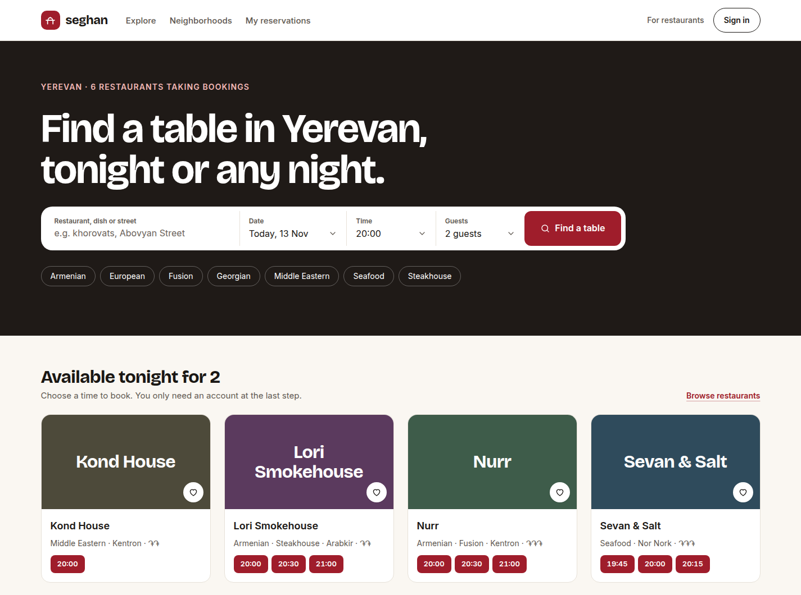
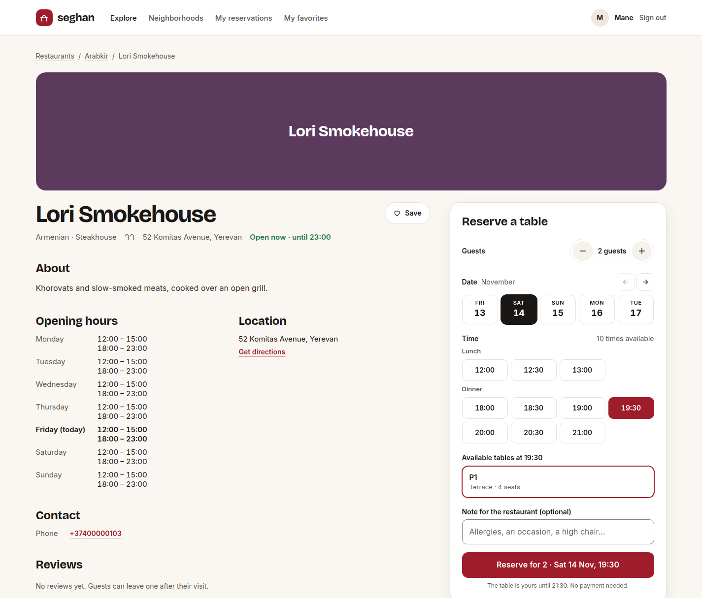
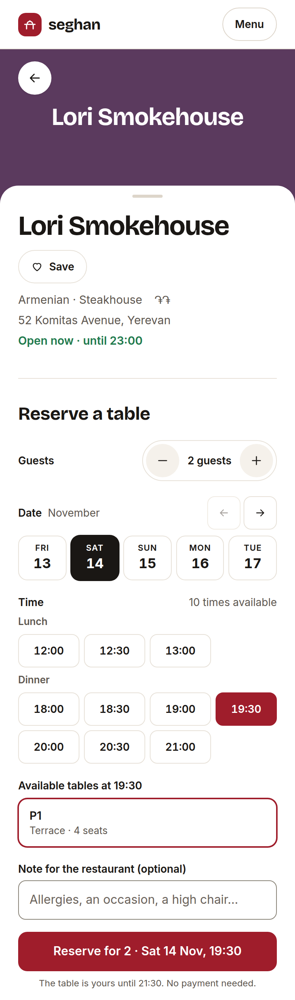

# Seghan

**Find a restaurant in Yerevan, pick a time, and reserve a table, while the restaurant manages every booking from its own dashboard.**

[](#tech-stack)
[](#tech-stack)
[](#tech-stack)
[](#run-it-locally)

Seghan (Armenian _սեղան_, "table") is a full-stack restaurant reservation platform, built as an internship project. Guests browse Yerevan restaurants, see which tables are free, and book one. Restaurant owners run their tables, opening hours and bookings from a private dashboard. PostgreSQL itself guarantees that a table can never be booked twice.



> **A local demo.** Seghan runs on your own computer with demo data, and isn't deployed anywhere. No booking ever reaches a real restaurant: the restaurants are samples, and the real Yerevan places that can be imported are marked "This is a test booking. The restaurant won't receive it."

**Get started:** [Run it locally](#run-it-locally) · [Try the demo](#try-the-demo) · [Tests and checks](#tests-and-checks)

## What you can do

### As a guest

- **Find a table:** search by name, dish or street, choose a day, time and party, and filter by cuisine, district and price. Each restaurant card shows its free times nearest yours.
- **Book it:** open a restaurant, choose the number of guests, a day, a time and one of the tables free then, and leave the restaurant a note. Times that have no table for your party are shown, struck through.
- **Manage your bookings:** on _My reservations_, see your upcoming and past bookings, get directions, and cancel a booking until it starts.
- **Review and save:** review a visit once the restaurant marks you as arrived, and save restaurants to _My favorites_.

If someone else takes the table first, the page says so and shows the tables still free.

### As a restaurant owner

- **Run the day:** see the day's reservations, refreshed every 30 seconds, with the guests expected and those waiting to be confirmed. Confirm or decline bookings, mark guests arrived or no-show, and filter or search the list.
- **Set up the restaurant:** manage its tables and capacity, with a floor plan of how each table stands right now. Set the week's opening hours, split shifts and late nights included. Block a table or the whole restaurant for a date or a time range.
- **Keep it current:** edit the restaurant's details and photos, publish it when it's ready, and follow its bookings, guests, no-shows and rating over 7, 30 or 90 days.

### As an admin

Look through every user, restaurant and booking on Seghan, see Seghan-wide analytics, and hide a restaurant from guests.

### On a phone

Every page is built for phones first. On a restaurant's page, the booking panel rises over the cover as a sheet.

<details>
<summary><strong>More screenshots</strong></summary>

**Booking a table:** a restaurant's page, with the guests, a day, a time and a free table chosen.



**The owner's day:** a restaurant's reservations for one day, with the day's figures and each booking's actions.


**Booking on a phone:** the booking panel as a sheet over the restaurant's cover.



</details>

## How double bookings are prevented

Two people may try to book the same table at the same moment. Exactly one of them succeeds, and this is enforced in three layers:

1. **The database refuses an overlap.** An exclusion constraint on `Reservation` (`btree_gist`) means no two active bookings on one table can overlap in time. `[)` ranges let one booking end exactly when the next begins:

   ```sql
   ALTER TABLE "Reservation"
     ADD CONSTRAINT "Reservation_no_overlap"
     EXCLUDE USING gist (
       "tableId" WITH =,
       tstzrange("startsAt", "endsAt", '[)') WITH &&
     )
     WHERE ("status" IN ('PENDING', 'CONFIRMED', 'ARRIVED'));
   ```

2. **A booking is one transaction that takes turns.**
   - It locks the table's row (`SELECT … FOR UPDATE`), then takes a shared lock on the restaurant's row (`FOR KEY SHARE`).
   - It then runs the four checks: is the restaurant open, does the table fit the party, is it free, and is it blocked?
   - Only then does it save the booking as pending.
   - Blocks and table changes lock the same rows, always in the same order, so they can never cross a booking.
3. **Only a real conflict is a conflict.** An overlap the database refuses (SQLSTATE `23P01`), or one the checks find, answers `409 SLOT_TAKEN`. Any other database error stays a logged `500`, so a fault never passes for a taken table. Status changes, such as a confirm crossing a cancel, apply only if the status is still the expected one.

These are proven on real PostgreSQL, not mocks. Among the database tests, 20 bookings for one table fired at the same moment always produce exactly one success and nineteen `409`s.

## Tech stack

| Area                           | Choice                                                                                                                  |
| ------------------------------ | ----------------------------------------------------------------------------------------------------------------------- |
| Frontend                       | React 19, TypeScript 7, Vite 8, React Router 8, Tailwind CSS 4, TanStack Query 5, React Hook Form and Zod 4             |
| Backend                        | Node.js 24, Express 5 (REST, JSON), TypeScript 7, Zod 4, pino                                                           |
| Database                       | PostgreSQL 17 in Docker, Prisma ORM 7                                                                                   |
| Sign-in                        | Email and password (argon2id), or Google Sign-In; a JWT access token and a rotating refresh token in `httpOnly` cookies |
| Outside services, all optional | Cloudinary (photos), Resend (booking emails), Geoapify (OpenStreetMap maps)                                             |
| Quality                        | Vitest, Supertest, Testing Library, oxlint, Prettier                                                                    |

Times are stored in UTC and shown on the restaurant's clock (`Asia/Yerevan`). Nothing important is ever deleted: restaurants are unpublished, tables switched off and bookings cancelled instead.

## Run it locally

You need **Node.js 24**, **npm 11** and **Docker**.

```bash
# 1. Install everything (one root node_modules for both workspaces).
npm install

# 2. Create your settings from the templates. They're never committed.
cp backend/.env.example backend/.env
cp frontend/.env.example frontend/.env
```

Then edit `backend/.env`:

| Setting                                                   | What to put                                                                                                                                    |
| --------------------------------------------------------- | ---------------------------------------------------------------------------------------------------------------------------------------------- |
| `POSTGRES_PASSWORD`, `DATABASE_URL`                       | A password of letters and digits, the same in both                                                                                             |
| `JWT_ACCESS_SECRET`                                       | At least 32 characters, for example from `openssl rand -base64 32`                                                                             |
| `DEMO_PASSWORD`                                           | Uncomment it and choose 8 to 128 characters. Every demo account gets this password                                                             |
| `GOOGLE_CLIENT_ID`                                        | Your Google web client ID, or, to run without Google, any value of the same shape, such as `000000000000-localdemo.apps.googleusercontent.com` |
| `GOOGLE_PLACES_API_KEY`, `CLOUDINARY_*`, `RESEND_API_KEY` | The server needs them to start, but the placeholders are enough for the demo (see _Optional services_)                                         |

In `frontend/.env`, set `VITE_GOOGLE_CLIENT_ID` to the same Google client ID, or **leave it empty** to hide the Google button.

```bash
# 3. Start PostgreSQL 17 in Docker (it listens only on this computer, on port 5432).
docker compose --env-file backend/.env -f backend/docker/docker-compose.yml up -d

# 4. Create the tables, the constraints and the Prisma client.
npm run db:migrate -w backend

# 5. Load the demo data into yerevan_dev: users, 7 restaurants with tables and hours, and bookings.
npm run db:seed -w backend

# 6. Run the API (http://localhost:4000) and the app (http://localhost:5173) together.
npm run dev
```

Open **http://localhost:5173**. Vite forwards `/api` to the API, so the browser only ever talks to one address.

Two more database commands: `npm run db:studio -w backend` lets you browse the data, and `npm run db:reset -w backend` rebuilds the local database from scratch, erasing it, after which you run `db:seed` again.

### Try the demo

Sign in with one of the demo accounts. The password is the `DEMO_PASSWORD` you chose.

| Account                                                     | Role                                                             | Try                                                                             |
| ----------------------------------------------------------- | ---------------------------------------------------------------- | ------------------------------------------------------------------------------- |
| `lilit@example.com`, `aram@example.com`, `mane@example.com` | Guest                                                            | Book a table, cancel it on _My reservations_, save favorites                    |
| `ani.owner@example.com`                                     | Owner of Lori Smokehouse, Nurr and Tsiran Wine Room              | Confirm and decline bookings, mark guests arrived, set tables, hours and blocks |
| `davit.owner@example.com`                                   | Owner of Sevan & Salt, Kond House, Tbilisi Courtyard and a draft | Publish the draft, see another owner's view                                     |
| `admin@example.com`                                         | Admin                                                            | Look through users, restaurants and bookings, and hide a restaurant             |

A good path: book a table as Lilit, sign in as Ani to confirm it, then mark Lilit arrived when the time comes. Lilit can then review the visit. You can also open the same table in two windows to watch only one booking succeed. In development, **http://localhost:5173/design** shows every component and screen in its states, with sample data.

### Optional services

- **Google Sign-In:** a Google Cloud web client ID in both `.env` files, with `http://localhost:5173` as an authorized origin.
- **Photos (Cloudinary):** real Cloudinary keys let owners upload photos. With the placeholders, restaurants show a colored cover instead.
- **Booking emails (Resend):** a real key emails guests when a booking is requested, confirmed or cancelled. Until a domain is verified, Resend's test sender only delivers to your own Resend address. With the placeholder, each email fails quietly and is logged, and the booking still goes through.
- **Maps (Geoapify):** a free Geoapify key draws an OpenStreetMap map on each restaurant's page. Left empty, the page shows the address and a Google Maps link.
- **Real Yerevan restaurants (demo listings):**
  - `npm run demo:import -w backend` adds 10 real places from the reviewed list in `backend/prisma/demo-listings/listings.json`, with sample tables for test bookings.
  - It needs real Cloudinary keys, because it copies the photos there.
  - Some of their photos come from the restaurants' own sites. Those are licensed for this private demo only (`"freeLicense": false`), and must be replaced, or permission asked, before any public use.

## Tests and checks

```bash
npm run typecheck                # TypeScript, frontend and backend
npm run lint                     # oxlint
npm test                         # unit, API and component tests: no database or Docker needed
npm run test:db -w backend       # the real-PostgreSQL tests, with Docker running
```

`test:db` creates and migrates its own database, `yerevan_test`, beside `yerevan_dev` on the same server, and refuses to run against any other. It never touches your demo data. At the last run, 1,347 frontend tests, 1,108 backend tests and 122 database tests all pass.

## Project structure

```text
frontend/                  React app (Vite)
  src/components/          shared UI
  src/features/<name>/     each feature's components, hooks and rules; design/ is the /design page
  src/pages/               one per address
backend/                   Express API
  src/modules/<name>/      routes → controller → service (rules and Prisma) → Zod schemas
  prisma/                  schema, migrations, seed and demo listings
  docker/                  docker-compose.yml for PostgreSQL 17
  tests/                   API and unit tests; tests/db/ runs on real PostgreSQL
```

## Status and limitations

- **A local internship demo:** it isn't deployed, and there's no live address. Bookings stay on your computer and never reach a restaurant.
- **Demo listings stay pending:** nobody confirms test bookings at the imported real places, so they stay pending, and those places get no reviews.
- **Opening hours:** saving opening hours doesn't yet check upcoming bookings that would fall outside them.
- **Late bookings:** a booking must start before midnight, though it may end after it.
- **An unused setting:** the backend still asks for `GOOGLE_PLACES_API_KEY` at startup, but nothing uses it: real places come from OpenStreetMap instead. Any value works.
- **Out of scope:** payments, combining tables, waitlists, SMS, more languages and staff accounts.
